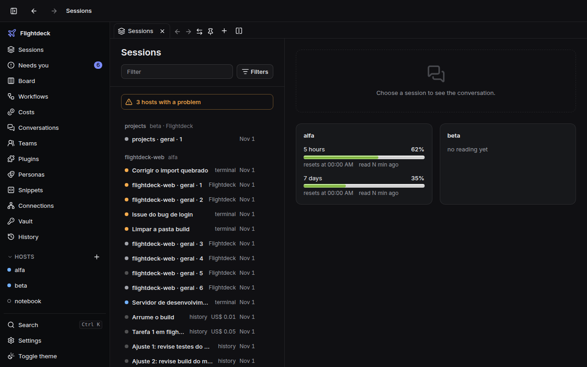
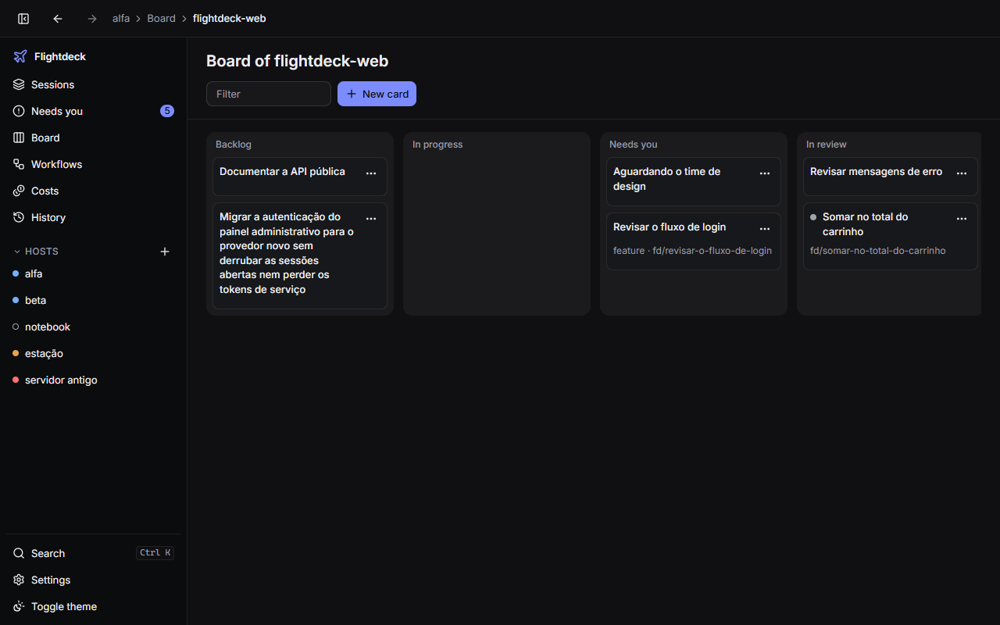
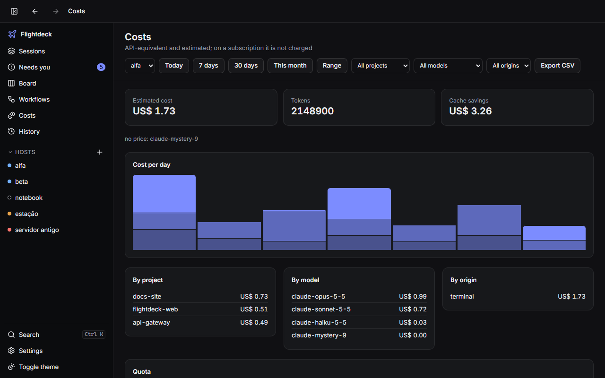

# Flightdeck

English | [Português (Brasil)](README.pt-BR.md)

[](https://github.com/jnerytech/flightdeck/actions/workflows/ci.yml)
[](LICENSE)
[](https://sonarcloud.io/summary/new_code?id=jnerytech_flightdeck)
[](https://sonarcloud.io/summary/new_code?id=jnerytech_flightdeck)
[](https://sonarcloud.io/summary/new_code?id=jnerytech_flightdeck)
[](https://sonarcloud.io/summary/new_code?id=jnerytech_flightdeck)
[](https://sonarcloud.io/summary/new_code?id=jnerytech_flightdeck)

**One desktop app to see, approve and drive every Claude Code session on all your machines.**

## What is Flightdeck

Flightdeck is a desktop app (Tauri 2 + React, Windows first) that centralizes your Claude Code
sessions across several hosts. Each host runs a small daemon, `flightdeckd` (Bun + TypeScript,
SQLite, WebSocket), that hosts sessions through the official Agent SDK and watches the ones you
start in a terminal. The app connects to every daemon, so you can follow, approve and message
sessions from one place, without opening each machine.



## Features

**Sessions**

- One hub for the sessions of all your hosts, grouped by project, with live state and a summary
  line for each.
- Sessions started in a terminal show up too, through opt-in Claude Code hooks.
- Approve or deny tool requests from the app, and send messages to terminal sessions started with
  `flightdeckd claude`.
- "Always allow" rules written to the project's local Claude Code settings, never to your global
  ones.

**Work**

- A board per project: each card is a git worktree plus a session, with pull requests on GitHub
  and Azure DevOps.
- YAML workflows with agents, checks, approval gates, loops, parallel steps and budgets.
- Issues from GitHub or Azure Boards turned into cards, automations (schedules, PR comments,
  failed checks, labels), and an arena that runs one request in 2 to 4 variants to compare and choose.
- Risk seals on every permission request: a high-risk one asks you to hold the button for 2 seconds.
- Search the history of every host, including sessions that were not started in Flightdeck.
- Review what a session or a card changed: comment on diff lines and send the review to the agent,
  revert or edit files, bring the PR comments to the agent and merge the card locally.
- A timeline per session: go back to the files of any turn (with a preview and an undo), fork the
  conversation from a turn, and edit the project's MCP servers, `CLAUDE.md`, agents and skills.
  Going back covers files only: it does not undo a database, the network or a `git push`.
- Files that are not tracked (such as `.env`) can follow a card into its worktree: list them in
  `.worktreeinclude` at the root of the repository.
- A Claude Code statusline with your quota and cost: set `statusLine` to
  `flightdeckd statusline`. Flightdeck never writes that setting; to keep a statusline you already
  have, call both in one script and join the lines (see the manual).

**Cost and quota**

- Estimated cost per project, model and origin, with CSV export.
- Plan quota bars with a projection of when the window runs out, a quota queue, and budgets in
  US$ that alert you or hold new cards.

**Desktop**

- Tabs with their own history, pinned, reordered and kept between starts, and a split view with
  two areas side by side or stacked.
- An embedded terminal on any host, in a tab, with no SSH: it survives the app and reattaches
  with its scrollback. "Open Claude here" runs `flightdeckd claude` in it, and the session is
  approvable from the app.
- Tray menu to approve requests without opening the window, and a `Ctrl+K` palette.
- Signed auto-update for the app and for the daemons.
- Light and dark themes; English and Portuguese.

## Screenshots

| Approval, with Always allow | Light theme |
| --- | --- |
|  |  |

| Board | Costs |
| --- | --- |
|  |  |

## Install

Download from the [Releases](https://github.com/jnerytech/flightdeck/releases) page:

| File | What it is |
| --- | --- |
| `Flightdeck_<version>_x64-setup.exe` (or `.msi`) | the desktop app for Windows |
| `flightdeckd-windows-x64.exe`, `flightdeckd-linux-x64`, `flightdeckd-linux-arm64` | the daemon, one per host |
| `SHA256SUMS` | the SHA-256 of each file |

1. **Verify the download.** On Linux: `sha256sum -c SHA256SUMS --ignore-missing`. On Windows
   (PowerShell): `(Get-FileHash .\<file>).Hash.ToLower()`, compared with the line in `SHA256SUMS`.
2. **Run the app installer.** It has no Windows code signature, so SmartScreen shows "Windows
   protected your PC". With the hash verified, click **More info**, then **Run anyway**.
3. **Install the daemon on each host**, with Claude Code installed and logged in. See the Quick
   start below.

Building from source is covered in the [manual](docs/manual/en.md#from-source).

## Quick start

1. **Install the daemon as a service** (on Linux, `chmod +x` the binary first). On Windows use
   `flightdeckd-windows-x64.exe` and `~\.flightdeck\bin\flightdeckd.exe`.

   ```sh
   ./flightdeckd-linux-x64 update --from ./flightdeckd-linux-x64   # installs to ~/.flightdeck/bin
   ~/.flightdeck/bin/flightdeckd service install
   ```

   The commands below assume `~/.flightdeck/bin` is on your `PATH`; otherwise use the full path
   (`~\.flightdeck\bin\flightdeckd.exe` on Windows). The first run creates
   `~/.flightdeck/config.json`. Set `allowedRoots` there to the folders
   where sessions may run (with an empty list no session can be created), then restart:
   `flightdeckd service stop && flightdeckd service start`. For a host other than this machine,
   also set `bind` and `allowedNetworks`
   ([remote access](docs/manual/en.md#remote-access-over-tailscale)).

2. **Pair.** Print a link and QR code for the app:

   ```sh
   flightdeckd pair
   ```

3. **Add the host in the app.** Click **Add host**, paste the `flightdeck://` link, and confirm
   with **Test and add**.

4. **Install the hooks** (opt-in) so terminal sessions show up. You can also use the **Install
   hooks** button on the host page, which needs no restart:

   ```sh
   flightdeckd hooks install    # run service stop / service start if the daemon is already running
   ```

5. **Start Claude Code through Flightdeck** to let the app send messages to the session:

   ```sh
   flightdeckd claude          # same arguments as claude; suggested alias: fd
   ```

## How it works

Each host runs one `flightdeckd`. It starts Claude Code sessions through the Agent SDK, receives
events from the Claude Code hooks, indexes the Claude Code transcripts that already exist on the
host, and stores everything in a local SQLite database. The desktop app opens one WebSocket per
daemon and merges them into a single view. Hosts are independent: nothing is copied between them.

```text
┌───────────────────────┐   WebSocket + token   ┌────────────────────────────────┐
│ Flightdeck app        │◄─────────────────────►│ flightdeckd, host A            │
│ (Tauri 2 + React)     │                       │  Agent SDK sessions            │
│                       │                       │  Claude Code hooks receiver    │
│  hub · board · costs  │   (over Tailscale     │  history index (SQLite)        │
│  tray · palette       │    for remote hosts)  │  git worktrees · PRs           │
│                       │                       └────────────────────────────────┘
│                       │◄─────────────────────►┌────────────────────────────────┐
└───────────────────────┘                       │ flightdeckd, host B  (same)    │
                                                └────────────────────────────────┘
```

## Security model

- **Token per host.** The app connects with a random token stored in the operating system's
  credential store. Tokens never appear in the logs, and `flightdeckd pair --rotate` replaces one.
- **Folders.** Sessions can only be opened inside `allowedRoots`; paths are resolved with
  realpath, so `..` and symlinks out of the roots are refused.
- **Networks.** By default only loopback connections are accepted. Any other origin needs an
  explicit `allowedNetworks` entry, and exposing a port to the open internet is not supported.
- **Opt-in hooks.** The only thing Flightdeck writes to `~/.claude` is the hook entries, and only
  when you ask (`flightdeckd hooks install`). It keeps a backup and `hooks uninstall` removes
  them. Transcripts are only read. "Always in this project" writes to the project's own
  `.claude/settings.local.json`, not to `~/.claude`.
- **Terminals.** An embedded terminal is a full shell on the host. It is on by itself only when
  the daemon listens on loopback; turning it on for a host reachable from other networks asks
  for confirmation. Its content never goes to the log or to the database.
- **Nothing is approved without a click.** Workflow `check` commands run only if you trusted the
  workflow, and a changed file asks for trust again.
- **Signed updates.** The app and the daemon install only updates signed with the project's key
  ([`release/flightdeck.pub`](release/flightdeck.pub)). The Windows installer itself is not
  code-signed.

## Documentation

- Manual: [English](docs/manual/en.md) | [Português (Brasil)](docs/manual/pt-BR.md)
- Roadmap and specs: [`docs/SPEC.md`](docs/SPEC.md)
- Decisions and deviations from the specs: [`docs/DECISIONS.md`](docs/DECISIONS.md)

The specs, decisions and glossary are written in Portuguese.

## Development

Prerequisites: [Bun](https://bun.sh) 1.4 or newer, and Claude Code installed and logged in. For
the desktop app, stable Rust and the
[Tauri 2 prerequisites](https://v2.tauri.app/start/prerequisites/).

```sh
bun install
bun run typecheck      # tsc in every workspace and in the scripts
bun run lint           # Biome
bun run test           # tests with 100% coverage + a check that no source file is left out
bun run smoke          # end to end against the real daemon with the fake runtime
bun run build:daemon   # binaries in dist/
bun run demo           # two fake hosts and the app's web entry, at http://localhost:1420
```

## Configurar o daemon

Na primeira execução o daemon cria `~/.flightdeck/config.json` com valores padrão e um token
aleatório. Nos sistemas que suportam, o arquivo fica legível só pelo dono.

```json
{
  "hostName": "meu-pc",
  "bind": "127.0.0.1",
  "port": 7420,
  "token": "<gerado>",
  "dataDir": "~/.flightdeck/data",
  "allowedRoots": ["C:/Users/eu/projetos", "~/code"],
  "runtime": "claude",
  "defaultPermissionMode": "default",
  "allowApiKey": false
}
```

- **`allowedRoots`** é obrigatório na prática: sessões só podem ser abertas em pastas dentro
  dessas raízes. O caminho é resolvido com realpath, então `..` e symlinks que saem das raízes
  são recusados. Com a lista vazia, nenhuma sessão pode ser criada, e o daemon avisa no boot.
- `bind` fica em `127.0.0.1`. Para escutar em outra interface, mude o `bind` explicitamente.
- `token` é o que o app usa para conectar. Ele nunca aparece nos logs.
- `claudePath` (opcional) aponta para o executável `claude`. Nos binários compilados, o daemon
  usa o `claude` do `PATH`.

## Subir o daemon

Pelo código-fonte:

```sh
bun run --filter @flightdeck/daemon start
# ou, com opções:
bun apps/daemon/src/bin.ts start --config ~/.flightdeck/config.json --runtime claude
```

`--runtime fake` sobe o daemon com um runtime determinístico, sem rede e sem gastar cota. Serve
para testar o app.

Binário único:

```sh
bun run build:daemon   # gera dist/flightdeckd-windows-x64.exe, -linux-x64 e -linux-arm64
./dist/flightdeckd-linux-x64 --config ~/.flightdeck/config.json
```

O daemon imprime `flightdeckd <versão> listening on ws://127.0.0.1:7420/v1/ws (runtime=claude)`.

## Conectar o app desktop

```sh
cd apps/desktop
bun run tauri dev      # desenvolvimento
bun run tauri build    # instalável
```

No app, clique em **Adicionar host** e cole o link de pareamento (veja [Pareamento](#pareamento))
ou informe nome, endereço (`127.0.0.1`, ou o `bind` configurado), porta (`7420`) e token (o valor
de `token` no `config.json` do daemon). **Testar e adicionar** faz `hello` e `host.info` antes de
salvar e mostra o motivo quando falha (token recusado, host fora do ar).

O token fica no cofre de credenciais do sistema operacional (Windows Credential Manager, Keychain,
Secret Service), não em texto puro. Depois, use **+** ao lado do host para criar uma sessão: pasta
dentro dos `allowedRoots`, nome, modo de permissão e primeiro prompt. Pedidos de ferramenta
aparecem como cards inline, com **Permitir** e **Negar**. O app reconecta sozinho (de 1 s a 30 s)
e retoma cada sessão do último evento visto.

## Instalar como serviço

O daemon sobrevive a reboot e a SSH fechado rodando como serviço do próprio usuário:

```sh
flightdeckd service install --dry-run   # mostra a unit ou a tarefa, não altera nada
flightdeckd service install [--config <arquivo>]
flightdeckd service status              # estado e a config que o serviço usa
flightdeckd service stop                # para o daemon; o serviço continua instalado
flightdeckd service start               # sobe o serviço e espera o /health
flightdeckd service uninstall           # para o daemon e remove o serviço
```

- **Config:** com `--config`, o serviço roda `start --config <caminho absoluto>`; sem, usa
  `~/.flightdeck/config.json`.
- **Parar:** o `stop` e o `uninstall` seguem a mesma sequência:
  - pedem `daemon.shutdown` ao daemon;
  - param a tarefa ou a unit;
  - esperam o lock do `dataDir`, encerrando o processo só se ele for o executável do serviço.

  No Windows, `schtasks /End` sozinho não basta: ele encerra o `conhost.exe` e deixa o daemon
  rodando. O `start` sobe o serviço e espera o `/health` da config dele por até 30 s.

- **Linux (WSL, Orange Pi, VPS):** grava `~/.config/systemd/user/flightdeckd.service`
  (`Restart=always`, `RestartSec=5`) e roda `systemctl --user enable --now flightdeckd`. Sem
  *linger*, o serviço só sobe depois do seu login; o `install` imprime o comando
  `sudo loginctl enable-linger $USER` para você rodar (ele nunca executa nada com sudo).
- **Windows:** cria a tarefa agendada `Flightdeck\flightdeckd` no logon do usuário, sem
  privilégio elevado e sem janela visível (importa um XML com `schtasks /Create /XML`; o console
  fica escondido por `conhost.exe --headless`).
- O comando do serviço é o binário compilado; rodando a partir do código-fonte, vira
  `bun run apps/daemon/src/bin.ts start`.
- Serviço não herda o `PATH` do shell: o `install` grava o caminho do `claude` em
  `claude.executablePath` na config (no Windows, prefere `claude.exe`; um `.cmd` gera aviso).
  O `--dry-run` só mostra o caminho que seria gravado e não cria nem altera a config.
- Serviço também não carrega o `.bashrc`: faça `claude auth login` em cada host em vez de
  depender de `CLAUDE_CODE_OAUTH_TOKEN` exportado no shell.
- Dois daemons com o mesmo `dataDir` não convivem: o segundo sai com código 3 ("já em execução").

### WSL a partir do Windows

O daemon do Windows pode manter o daemon de cada distro WSL rodando (e a distro acordada):

```json
"wsl": [{ "distro": "Ubuntu", "command": "~/.local/bin/flightdeckd start", "port": 7421 }]
```

Cada item vira `wsl.exe -d <distro> --exec bash -lc "<command>"`, reiniciado com backoff de 1 s
até 60 s, com log em `dataDir/logs/wsl-<distro>.log`. O daemon do WSL escuta em
`127.0.0.1:7421`, que o Windows alcança por `localhost`.

## Acesso remoto pela Tailscale

Por padrão só conexões de loopback são aceitas (`allowedNetworks`:
`["127.0.0.0/8", "::1/128"]`); qualquer outra origem recebe HTTP 403 antes do WebSocket, em
qualquer rota. Para usar a tailnet, ponha o `bind` no IP da tailnet (ou `0.0.0.0`) e libere as
faixas da Tailscale:

```json
"bind": "0.0.0.0",
"allowedNetworks": ["127.0.0.0/8", "::1/128", "100.64.0.0/10", "fd7a:115c:a1e0::/48"]
```

Não há TLS próprio: o túnel WireGuard da Tailscale cifra o tráfego. **Expor a porta na internet
aberta não é suportado.**

## Pareamento

```sh
flightdeckd pair            # imprime flightdeck://<ip>:<porta>?name=…&token=… e o QR
flightdeckd pair --rotate   # gera token novo; o daemon em execução derruba quem usava o antigo
```

O endereço é o IP da Tailscale (`tailscale ip -4`) quando existe, senão o `bind`. No app, cole o
link em **Adicionar host** ou abra-o direto (`flightdeck://` está registrado no sistema); o app
preenche o formulário, testa a conexão com `hello` e `host.info` e só salva depois que você
confirma.

## Deploy

`bun run deploy <alias>` lê `deploy.hosts.json` na raiz (fora do git):

```json
{ "pi": { "ssh": "ubuntu@orange", "target": "linux-arm64", "path": "~/.local/bin/flightdeckd" } }
```

Compila o alvo, copia com `scp` para `<path>.new`, troca o binário, reinicia com
`systemctl --user restart flightdeckd` via `ssh` e confere `systemctl --user is-active`.

Depois do primeiro `flightdeckd update` (abaixo), o serviço passa a rodar
`~/.flightdeck/bin/flightdeckd`: ajuste o `path` do `deploy.hosts.json` para esse caminho.

## Operação do host

### Versões e compatibilidade

- **Uma versão só:** o app, o daemon e o protocolo saem com a mesma versão (`0.7.0` nesta fase).
  `flightdeckd --version` imprime `flightdeckd 0.7.0 (protocolo 1)`.
- **No app:** a página do host mostra a versão do daemon, a do app e a do `claude`. Um daemon de
  outra versão ganha o selo **≠** ("versão diferente") na barra lateral: funciona, mas atualize
  quando puder.
- **Protocolo:** o app manda a versão de protocolo dele no `hello`. Se o daemon não a aceita, o
  host fica **incompatível: atualize o daemon**, com o comando na página do host. Ele não tenta
  reconectar e sai das listas (sessões, busca) até ser atualizado e reconectado.
- **Recursos:** o `host.info` anuncia o que o daemon tem (`central`, `workflows`,
  `maintenance`…), e o app esconde o que o host não anuncia. Um daemon anterior à Fase 7 não
  anuncia nada e continua aparecendo como antes, sem a seção Manutenção.

### Atualizar (`flightdeckd update`)

```sh
flightdeckd update --from <binário novo> [--allow-downgrade] [--config <arquivo>]
```

O `update` instala sempre em `~/.flightdeck/bin/flightdeckd` (`flightdeckd.exe` no Windows):

1. Roda `<binário novo> --version` e recusa o que não responder como um `flightdeckd`. Uma versão
   menor que a de quem roda o `update` só passa com `--allow-downgrade`.
2. Com o daemon rodando fora do serviço, recusa: "pare o daemon e rode de novo". Com serviço:
   - pede `daemon.shutdown` ao daemon e para o serviço;
   - espera o daemon soltar o `dataDir`;
   - se o lock continua preso, encerra o processo, mas só se ele for o executável do serviço.
3. Guarda o binário atual como `flightdeckd.old` (`.exe.old`) e põe o novo no lugar.
4. Se o serviço apontava para outro caminho (por exemplo `dist/` ou `~/.local/bin`), reinstala o
   serviço no caminho estável, com o mesmo `--config`. Os hooks do Claude Code são reescritos só
   se já estavam instalados e apontam para outro lugar. A saída diz o que foi reescrito.
5. Sobe o serviço e espera `GET /health` responder por até 30 s. Sem `--config` no `update`, a
   porta vem da config do serviço. Se o daemon novo não sobe:
   - o `.old` volta para o lugar;
   - o serviço volta ao caminho e à config de antes e sobe de novo;
   - o comando sai com 1.

   O `.old` de um update bem sucedido é apagado no próximo.

Sem serviço instalado, o `update` só instala o binário e diz como subir. Use o binário instalado
para rodar o `update` (ele compara a versão nova com a dele); na primeira vez, rode o próprio
binário novo.

- **Windows:** `bun run build:daemon`, depois
  `~\.flightdeck\bin\flightdeckd.exe update --from dist\flightdeckd-windows-x64.exe` (na primeira
  vez, `dist\flightdeckd-windows-x64.exe update --from dist\flightdeckd-windows-x64.exe`).
- **WSL:** copie o binário Linux para dentro da distro e rode o `update` lá:
  `cp /mnt/<drive>/<repo>/dist/flightdeckd-linux-x64 ~/` e
  `~/.flightdeck/bin/flightdeckd update --from ~/flightdeckd-linux-x64`.
- **Linux remoto (VPS, Orange Pi):** `scp dist/flightdeckd-linux-arm64 <host>:~/` e, no host,
  `~/.flightdeck/bin/flightdeckd update --from ~/flightdeckd-linux-arm64`.

### Atualização automática (assinada)

Cada release traz os instaladores e os daemons assinados com a chave do projeto (minisign, gerada
pelo `tauri signer`). A chave pública está em `release/flightdeck.pub`, e o app e o daemon só
aceitam o que ela assinou.

- **O app:**
  - procura a versão nova ao abrir e a cada 6 h, no `latest.json` da última release;
  - com uma versão nova, mostra a faixa "Flightdeck X disponível", com as notas, **Instalar e
    reiniciar** e **Depois**;
  - assinatura inválida ou download quebrado aparecem na faixa, e nada é instalado;
  - em **Configurações**: **Procurar atualização agora** e **Avisar sobre atualizações** (ligado
    por padrão).
- **O daemon:**
  - verifica o `daemon-latest.json` ao subir e a cada `updates.checkIntervalH` (24 h);
  - na página do host, o app mostra **Atualizar daemon para X** quando há versão nova, e pede
    confirmação;
  - o daemon baixa o binário do próprio sistema para `<dataDir>/updates/`, confere o sha256 e a
    assinatura, e roda o `flightdeckd update --from` fora do serviço, para sobreviver à própria
    parada: uma tarefa única `Flightdeck\update` no Windows e `systemd-run --user` no Linux;
  - o host mostra "atualizando…" até reconectar na versão nova.
- **Ordem:** com o app e os daemons atrasados, a faixa sugere atualizar primeiro o app.

```json
{ "updates": { "manifestUrl": "https://github.com/jnerytech/flightdeck/releases/latest/download/daemon-latest.json",
               "checkIntervalH": 24 } }
```

Só o `flightdeckd` compilado verifica o GitHub por padrão. Rodando do código-fonte não há binário
para atualizar, e o `manifestUrl` padrão é `null`.

**Quando falha:**

- **"o daemon não roda como serviço":** a atualização pelo app precisa do serviço. Instale com
  `flightdeckd service install`, ou atualize à mão com `flightdeckd update --from`.
- **Verificação recusada** (sha256 ou assinatura): o arquivo baixado é apagado e nada muda. Baixe
  de novo da página de Releases e confira o `SHA256SUMS`.
- **O host não volta em 2 minutos:** a página do host mostra o comando manual. No host, rode
  `~/.flightdeck/bin/flightdeckd service status` e, se preciso, `flightdeckd update --from` com o
  binário da release. A volta automática do `update` restaura a versão anterior quando a nova
  não sobe.

### Retenção

```json
{ "retention": { "eventsDays": 90, "externalSessionsDays": 30 } }
```

- **Apaga:** eventos e pedidos de permissão de sessões gerenciadas encerradas há mais de
  `eventsDays` dias, e sessões externas encerradas há mais de `externalSessionsDays` dias. `0`
  apaga assim que a sessão encerra.
- **Nunca apaga:** sessões vivas, sessões fixadas, sessões de cards fora de Concluído (inclusive
  as etapas de workflow desses cards), os cards, as execuções de workflow e os nomes e
  marcações das sessões. O índice do histórico segue os transcripts e fica de fora.
- **Quando:** no boot do daemon e a cada 24 h. À mão, `flightdeckd db prune [--dry-run]` mostra
  a contagem por tabela; no app, a seção **Manutenção** da página do host tem **Simular** e
  **Limpar** (que pede confirmação).
- Uma conversa limpa aparece como "conversa removida pela retenção".

### Backup e restauração

```json
{ "backup": { "enabled": true, "keep": 7 } }
```

- **Automático:** uma vez por dia, `VACUUM INTO <dataDir>/backups/flightdeck-<AAAAMMDD-HHmmss>.db`
  (horário UTC), mantendo os últimos `keep`. Funciona com o daemon rodando.
- **À mão:** `flightdeckd backup [--out <arquivo>]`, ou **Fazer backup agora** na seção
  Manutenção. Os arquivos ficam só para o dono (0600 fora do Windows).
- **Restaurar:** `flightdeckd service stop`, depois `flightdeckd restore <arquivo>`, depois
  `flightdeckd service start`. Sem serviço, pare o daemon à mão antes do `restore`. O comando recusa com o daemon rodando, confere a integridade e se o backup não
  veio de uma versão mais nova, e guarda o banco atual em `flightdeck.db.before-restore`. As
  migrações que faltarem rodam no boot seguinte.
- **A `config.json` fica fora do backup**, porque tem os tokens: guarde uma cópia à parte.

## App desktop: frota e Windows

- **Precisa de você:** no topo da barra lateral, todos os pedidos de permissão abertos em todos os
  hosts, do mais antigo ao mais novo. **✓** e **✕** permitem ou negam ali mesmo, no host do
  pedido; clicar no pedido abre a sessão no card de aprovação.
- **Página do host:** clique no nome do host para ver sistema, versões, sessões ativas, latência
  do heartbeat, renomear, reconectar e remover. Um host que repassa a chave de API ao Claude
  ganha um selo ⚠.
- **Notificações** trazem o nome do host. **Bandeja:** ícone com Abrir, o submenu Precisa de
  você (N) (veja [Uso diário](#uso-diário)) e Sair; fechar a janela manda o app para a bandeja
  (desligável em Configurações).
  **Iniciar com o Windows** fica em Configurações, desligado por padrão.
- **Instância única:** abrir o app de novo (ou um link `flightdeck://`) foca a janela existente.

## Histórico

O daemon de cada host indexa os transcripts do Claude Code desse host, inclusive as sessões que
nasceram fora do Flightdeck (terminal, VS Code, Desktop). Os transcripts são só lidos: nada é
editado, apagado ou copiado entre hosts. A única escrita em `~/.claude` é a dos hooks, por
comando explícito (veja "Central de sessões").

### O que é indexado

- Cada arquivo `<id>.jsonl` em `~/.claude/projects/<pasta>/` é uma sessão; o id é o
  `claudeSessionId`. A pasta do projeto vem do campo `cwd` das linhas.
- Entra na busca o texto das mensagens do usuário e do assistente, mais uma linha
  `[ferramenta Nome]` por chamada de ferramenta. Resultados de ferramenta não entram, e cada
  mensagem é cortada em 8 KB.
- O formato é interno ao Claude Code. Tipos de linha desconhecidos ficam guardados crus e fora da
  busca; linhas que não são JSON são contadas como erro e puladas.
- A leitura é incremental (só o que foi acrescentado), por observação de arquivos e por varredura
  a cada 10 s. Um arquivo que encolheu é lido de novo do zero.
- A busca usa FTS5 do SQLite; sem ele, o daemon cai para `LIKE` e registra a decisão no boot.
- Uma sessão é marcada **possivelmente em uso** quando o arquivo mudou nos últimos 2 minutos.

As raízes ficam em `history.roots` na config, com padrão `["~/.claude/projects"]`:

```json
{
  "history": {
    "roots": ["~/.claude/projects"],
    "excludeCwds": ["~/clientes/sigiloso", "C:/Users/eu/privado"]
  }
}
```

### Excluir pastas

Sessões cujo `cwd` é uma pasta de `history.excludeCwds`, ou fica dentro dela, nunca entram no
índice. A comparação usa o `cwd` gravado nas linhas, nunca o nome do diretório em
`~/.claude/projects`. No Windows e no macOS ela ignora maiúsculas e o tipo de barra. Mudou a
lista? Reconstrua o índice (abaixo): sessões já indexadas só saem, e arquivos já excluídos só
voltam, depois disso.

### Reconstruir o índice

```sh
flightdeckd history reindex [--config <arquivo>]
```

Apaga o índice de histórico e lê todos os transcripts de novo, imprimindo quantas sessões e
mensagens entraram. Pare o daemon antes: com outro processo no mesmo `dataDir`, o comando sai com
código 3.

### No app

- **Histórico por host** (🕘 ao lado do nome do host): sessões indexadas com título, pasta, data
  da última mensagem, origem (`Flightdeck` ou `externa`) e o selo "possivelmente em uso";
  filtros por pasta, período (dias inteiros, em UTC) e origem.
- **Busca global** (`Ctrl+K` dentro do app, ou "Buscar no histórico"): é a última seção da
  [paleta](#paleta-ctrlk). Enter, sem nada escolhido, consulta todos os hosts online em paralelo e
  junta os acertos por data, com host, pasta e trecho destacado. Host offline, ou que não responde
  em 5 s, aparece como "sem resposta" sem travar o resto.
- **Leitor:** somente leitura, com o visual do chat, carregando páginas conforme a rolagem. Vindo
  da busca, abre no ponto do acerto; "Carregar anteriores" traz o começo.
- **Continuar no Flightdeck** transforma o transcript numa sessão gerenciada com `resume`. Se a
  sessão estiver possivelmente em uso, o app pede confirmação antes, porque dois processos
  escrevendo na mesma conversa a corrompem. **Copiar comando** copia `claude --resume <id>` para
  usar no terminal.

### Atalho global

`Ctrl+Alt+F` traz o app para frente com a busca global aberta, mesmo com ele em segundo plano ou
na bandeja. Para mudar, abra **Configurações → Atalho global**, digite a combinação e clique em
**Salvar atalho**.

- Formato `Modificadores+Tecla`, por exemplo `Ctrl+Shift+Y`. A tecla é uma letra, um dígito ou
  `F1` a `F24`, e é preciso ao menos `Ctrl`, `Alt` ou `Super`.
- `Ctrl+K` é recusado: ele abre a busca dentro do app e, como atalho global, colidiria com o
  navegador e o VS Code.
- Se outro programa já usa a combinação, o app avisa e abre as Configurações para você escolher
  outra. O atalho só é salvo depois que o sistema o aceita.

## Board

Cada projeto (um repositório git do host) tem um board com cinco colunas: Backlog, Em andamento,
Esperando você, Em revisão e Concluído. Um card vira uma branch `fd/<slug>`, uma worktree e uma
sessão; o card anda sozinho conforme a sessão e o PR, e também pode ser arrastado à mão.

### Cadastrar um projeto

No app, o botão ▦ ao lado do host abre **Projetos de &lt;host&gt;**. Cada projeto registra:

- **Caminho do repositório:** precisa ser um repositório git dentro de `allowedRoots`.
- **Nome** e **branch base:** em branco, ficam o nome da pasta e a branch atual do repositório.
- **Provedor de PR:** `github`, `azure-devops` ou nenhum.
- **Script de preparação** (opcional, por exemplo `bun install`): roda na worktree antes da
  sessão, com `cmd.exe` no Windows e `sh` nos demais. É o único comando de shell que o
  Flightdeck executa por conta própria, e só existe se for cadastrado. Se falhar, o card vai para
  Esperando você com a saída do erro.
- **Modelo de instruções:** anexado ao prompt de todo card. O padrão pede para trabalhar só na
  worktree e fazer commits com mensagens descritivas.

Ao iniciar um card, o daemon roda `git worktree add <repo>/.flightdeck/worktrees/<slug> -b
fd/<slug> <base>` e acrescenta `.flightdeck/worktrees/` ao `.git/info/exclude` do repositório
(o `.gitignore` não é tocado). O prompt da sessão é a descrição do card mais o modelo.

- **Em revisão:** o card entra quando um turno termina bem. Um turno com erro, interrompido por
  Parar, ou um pedido de permissão levam a Esperando você.
- **Conclusão:** Concluir (com confirmação) ou o PR mesclado removem a worktree se `git status`
  estiver limpo. Senão, o card avisa e a worktree fica.
- **Descarte:** Descartar (com confirmação, e um aviso se houver alterações não enviadas)
  remove a worktree e a branch local.

### Provedores de PR

Abrir PR faz `git push -u origin fd/<slug>` e depois chama o CLI do provedor, com o título e a
descrição do card:

- **GitHub:** `gh pr create --base <base> --head fd/<slug>`. Estado e checks vêm de `gh pr view
  --json state,statusCheckRollup`.
- **Azure DevOps:** `az repos pr create --source-branch fd/<slug> --target-branch <base>`. Estado
  vem de `az repos pr show`, e os checks das políticas, de `az repos pr policy list`.

O CLI precisa estar instalado e autenticado no host do daemon (`gh auth login`, `az login` com a
extensão `azure-devops`). O daemon só o invoca, procurando-o no PATH. O merge continua no
provedor. Os cards com PR aberto são consultados a cada 60 s, ou a cada
`board.prPollIntervalMs` da config. PR mesclado leva o card a Concluído; fechado sem merge, a
Esperando você.

### Limite de execuções paralelas

`maxParallelRuns` (padrão 2) limita quantos cards do host rodam ao mesmo tempo, para não esgotar
a cota da assinatura com agentes em paralelo. Os cards iniciados além do limite ficam em Em
andamento com o selo "na fila", em ordem de início. Eles sobem quando uma execução termina, é
interrompida ou fica ociosa.

- Sessões abertas fora do board não contam no limite.
- O limite fica na config do daemon e pode ser trocado na tela Projetos, que grava de volta no
  `config.json`:

```json
{ "maxParallelRuns": 2, "board": { "prPollIntervalMs": 60000 } }
```

## Workflows

Um card pode rodar um workflow em vez de uma sessão só: uma sequência de etapas (agentes,
verificações, aprovações suas), com orçamento, acompanhada e aprovada pelo app.

### Declarar

Os workflows são arquivos `.flightdeck/workflows/<nome>.yaml`, versionados no próprio
repositório. O daemon sempre os lê da branch base do projeto (`git show <base>:<caminho>`). Um
workflow escrito pelo agente na branch do card nunca é usado.

```yaml
name: feature
inputs: [task]
budget: { maxTurns: 80, maxMinutes: 120, maxCostUsd: 15 }
steps:
  - id: plan
    agent: { prompt: "Planeje: {{inputs.task}}", permissionMode: plan }
  - id: approve-plan
    gate: { message: "Aprovar o plano?", show: "{{steps.plan.output}}" }
  - id: implement
    agent: { prompt: "Implemente este plano e faça commits:\n{{steps.plan.output}}" }
  - id: tests
    loop:
      max: 3
      until: { check: "bun test" }
      do:
        agent: { continue: implement, prompt: "Os testes falharam:\n{{loop.lastCheck.output}}" }
  - id: review
    parallel:
      - agent: { prompt: "Revise o diff com foco em segurança." }
      - agent: { prompt: "Revise o diff com foco em legibilidade." }
  - id: pr
    pr: {}
```

| Etapa | O que faz |
| --- | --- |
| `agent` | Abre uma sessão na worktree do card. Com `continue: <id>`, manda a mensagem à sessão daquela etapa. A saída é o texto do assistente no turno. |
| `check` | Roda o comando na worktree. Guarda o código de retorno e os últimos 8 KB da saída. Se o comando falhar, a execução falha. |
| `gate` | Pausa até você aprovar ou recusar, com nota opcional. A nota é a saída do gate. |
| `loop` | Roda o `check` do `until`. Enquanto ele falhar, roda o `do` (no máximo `max` vezes). Esgotado o `max`, a execução pausa. |
| `parallel` | Roda os itens ao mesmo tempo, dentro de `maxParallelRuns`. As saídas chegam em `outputs`, na ordem declarada. |
| `pr` | Faz o push e abre o PR pelo provedor do projeto. |

A interpolação aceita só `{{inputs.*}}`, `{{steps.<id>.output}}` (`outputs` num `parallel`) e
`{{loop.lastCheck.output|exitCode}}`, este dentro do `do` de um loop. Uma referência
desconhecida, um campo desconhecido, uma etapa sem `id` ou um `continue` para uma etapa que não
é um `agent` anterior são erros de validação. Um valor interpolado maior que 8 KB é cortado.

### Confiar

As etapas `check` rodam comandos de shell: `cmd.exe /d /s /c` no Windows e `sh -c` nos demais,
como o script de preparação. Por isso, cada workflow precisa ser confiado antes da primeira
execução. Na tela Projetos, **Workflows de &lt;projeto&gt;** lista os workflows da base com a
validação e os comandos `check`. **Confiar** mostra esses comandos e pede confirmação.

- **O que fica guardado:** a confiança guarda o hash (sha256) do arquivo.
- **Se o arquivo mudar na base:** o hash muda, e o workflow volta a pedir confiança.
- **Antes de cada check:** o daemon confere que o comando está literalmente no workflow da
  execução e que esse conteúdo continua confiado. Qualquer outro comando é recusado sem chegar
  ao shell.

### Rodar e acompanhar

No detalhe do card, escolha o workflow (ou **Nenhum**, para o card simples da Fase 4),
preencha os `inputs` e clique em Iniciar.

- **Linha do tempo:** o detalhe mostra cada etapa com status, tentativa, duração e, num `agent`,
  os turnos e o custo estimado. Clicar abre a conversa da etapa ou a saída do `check`.
- **Gate aberto:** leva o card a Esperando você e libera a vaga do host. Ele aparece no próprio
  card e em **Precisa de você**, com Aprovar, Recusar e nota.
  - Aprovado, a execução volta à fila do host e segue.
  - Recusado, termina como `rejected`.
- **Etapa `pr`:** leva o card a Em revisão. O merge leva a Concluído e fecha as sessões das
  etapas.
- **Reinício do daemon:** a execução retoma de onde parou.
  - Um agent no meio do turno retoma a sessão e reenvia o prompt, precedido de "A execução foi
    interrompida; continue de onde parou."
  - Um check roda de novo.
  - Um gate continua aberto.

### Orçamento

`budget` limita a execução inteira, somando todas as suas sessões:

- **Turnos:** contados entre todas as sessões.
- **Minutos:** o tempo de relógio dos turnos.
- **Custo:** o que o SDK informa (`total_cost_usd`). Em assinatura, é uma estimativa útil como
  teto.
  - O valor é cumulativo por sessão: vale o último total de cada sessão.
  - Uma sessão retomada conta só a diferença.

O orçamento é conferido antes de cada turno. Estourado, a execução pausa em Esperando você com
o motivo. Uma execução pausada não continua: inicie o card de novo. O medidor no detalhe do
card mostra turnos, minutos e custo estimado.

### `flightdeckd mcp`

`flightdeckd mcp [--config <arquivo>]` é um servidor MCP stdio para o Claude Code do mesmo host.
Ele lê a config do daemon e conecta no daemon local pelo protocolo, com o token da config. Isso
deixa uma sessão do Claude criar cards e disparar workflows. Ferramentas:

- `list_projects` e `list_workflows`;
- `create_card` e `start_card` (com `workflow` e `inputs`);
- `get_card` e `get_run`.

Não há ferramenta para aprovar permissões nem para responder gates: isso fica só com você, no
app. Para registrar no Claude Code:

```sh
claude mcp add flightdeck -- flightdeckd mcp
```

## Central de sessões

A tela **Sessões** é a principal do app: todas as sessões do Claude Code dos hosts online, num lugar só, agrupadas por projeto e ordenadas pela última atividade.

### O que aparece na lista

| Origem | De onde vem |
| --- | --- |
| Flightdeck | sessões que o próprio daemon roda (`session.list`) |
| terminal | sessões abertas fora do Flightdeck, no terminal ou no terminal integrado do VS Code, vistas pelos hooks do Claude Code (`external.list`) |
| histórico | transcripts indexados de `~/.claude/projects` (`history.list`) |

Uma sessão aparece uma vez só. A ordem de preferência é gerenciada, depois terminal, depois histórico.

- **Grupo:** é o projeto. Vale o `remote.origin.url` do repositório da pasta da sessão, normalizado, de modo que SSH e HTTPS do mesmo repositório caem juntos. Worktrees contam como o repositório principal. Sem remoto, vale a raiz do repositório; sem repositório, a pasta.
- **Linha:** mostra host, origem, estado (rodando, precisa de você, ociosa, encerrada), o selo "controlável" e a hora.
- **Resumo:** abaixo, uma linha tirada do transcript, sem IA: "Pedido: <primeira linha do último prompt, até 80 caracteres>" e o que a sessão faz agora ("rodando Bash", "esperando aprovação de Write", "ociosa há 12 min"). O daemon manda isso no campo `summary` das listas.
- **Filtros:** texto, host, origem, estado, "Só fixadas" e "Mostrar arquivadas". As arquivadas ficam fora por padrão.
- **Menu:** renomear, fixar (as fixadas vão para o topo do grupo), arquivar e "Copiar comando" (`flightdeckd claude --resume <id>`).
- **Abrir uma sessão:**
  - gerenciada: abre a conversa;
  - do terminal ainda viva: abre o transcript ao vivo, com os pedidos de permissão dela e, se for controlável, a caixa de mensagem;
  - encerrada ou do histórico: abre o leitor, com "Continuar no Flightdeck".

### Hooks do Claude Code

As sessões abertas fora do Flightdeck só aparecem com os hooks instalados no host. Há dois caminhos, e ambos são opt-in: na tela do host, o botão **Instalar hooks**, que pede confirmação, ou no terminal do host:

```sh
flightdeckd hooks install     # grava as entradas do Flightdeck em ~/.claude/settings.json
flightdeckd hooks status      # instalados, ausentes ou desatualizados
flightdeckd hooks uninstall   # remove só as entradas do Flightdeck
```

- **O que é escrito:** é a única escrita do Flightdeck em `~/.claude`.
  - O `install` mescla as entradas com o que já existe, sem tocar nas outras chaves nem nos hooks de terceiros.
  - Antes, guarda uma cópia em `settings.json.flightdeck-backup`.
  - Reinstalar substitui as entradas antigas em vez de duplicar.
- **Entradas:**
  - `SessionStart` é um hook de comando: `<flightdeckd> hook session-start --url <receptor> --token <token>`. No Windows, o Claude Code roda hooks de comando pelo Git Bash, que trata `\` como escape. Por isso o caminho do executável é gravado com barras normais (`D:/...`). Uma instalação antiga, com barras invertidas, aparece como desatualizada no `hooks status`: rode `hooks install` de novo.
  - `UserPromptSubmit`, `Notification`, `PermissionRequest`, `PostToolUse`, `PostToolUseFailure`, `PermissionDenied`, `Stop` e `SessionEnd` são hooks http para o receptor do daemon, em `http://127.0.0.1:<hooks.port>`, com o cabeçalho de token.
- **Config:** `hooks.port` vale 7421 por padrão. `hooks.token` é gerado no primeiro install. `hooks.permissionTimeoutS` vale 600. `hooks.staleAfterS` vale 900; uma sessão sem eventos e sem mudança no transcript por esse tempo passa a encerrada.
- **WSL:** o daemon do WSL instala no `~/.claude` do WSL e precisa de um `hooks.port` diferente do Windows.
- **Instalar pelo CLI com o daemon rodando:** o daemon passa a receber os hooks depois de reiniciado. Instalando pelo app, o receptor sobe na hora.
- **O Claude nunca espera pelo Flightdeck:**
  - Com o daemon fora do ar, os hooks falham rápido e a sessão segue.
  - Sem nenhum app aberto, o pedido de permissão é respondido na hora, vazio, e o diálogo do terminal decide.

### Aprovar pelo app

Com o app aberto, o `PermissionRequest` de uma sessão do terminal espera a resposta e aparece em **Precisa de você**, com notificação do sistema. Enquanto isso, o diálogo do terminal continua ativo. Vale o que vier primeiro:

- **Aprovar ou Negar no app:** libera ou nega a ferramenta.
- **Responder no terminal:** o pedido sai da fila no próximo evento da sessão.

Nada é aprovado sem um clique.

### `flightdeckd claude` (alias `fd`)

```sh
flightdeckd claude [argumentos do claude]
# sugestão: alias fd="flightdeckd claude"
```

Abre o `claude` de verdade no mesmo terminal, com os mesmos argumentos e o mesmo código de saída, e acrescenta o canal do Flightdeck. O canal é um servidor MCP (`flightdeckd channel`) que deixa o app mandar mensagens para essa sessão como se você as digitasse.

- **Argumentos:** o wrapper acrescenta `--mcp-config` (arquivo temporário) e `--dangerously-load-development-channels server:flightdeck` e define `FLIGHTDECK_LAUNCH_ID`. O `.mcp.json` do projeto não é tocado.
- **Config:** como os argumentos são todos do `claude`, a config do daemon vem de `FLIGHTDECK_CONFIG`, ou do caminho padrão.
- **Sem `claude` no PATH** (nem em `claude.executablePath`): avisa e sai.
- **Sem o daemon:** avisa e abre o `claude` assim mesmo, sem canal.
- **Com `-p` ou `--print`:** abre o `claude` normal, sem canal e sem aviso. O modo print ignora o canal de desenvolvimento.
- **Research preview:** o canal é um recurso de pré-visualização do Claude Code. Cada abertura mostra um aviso de canal de desenvolvimento, que precisa ser aceito.
- **Aviso conhecido:** na abertura, o Claude Code mostra `server:flightdeck · no MCP server configured with that name`, mesmo com o canal funcionando. O aviso é avaliado antes dos servidores do `--mcp-config` e pode ser ignorado.

| | `claude` puro | `flightdeckd claude` |
| --- | --- | --- |
| aparece na lista, com estado ao vivo | sim (com hooks) | sim (com hooks) |
| aprovar e negar pelo app | sim | sim |
| transcript ao vivo | sim | sim |
| mandar mensagem pelo app | não | sim (selo "controlável") |

### Por que a extensão do VS Code fica de fora

A extensão do Claude Code para VS Code e o app Claude Desktop rodam o `claude` em modo SDK, que ignora o canal de desenvolvimento. Na prova de conceito, o canal subiu como MCP dentro da extensão, mas nenhuma mensagem chegou. O terminal integrado do VS Code é um terminal comum: lá, `flightdeckd claude` funciona.

## Cota, uso e "permitir sempre"

### Cota do plano

Cada turno de uma sessão gerenciada traz a cota do plano do Claude. Todas as sessões de um host
usam o mesmo login, então a cota é do host. O daemon guarda a última leitura de cada janela (5
horas, 7 dias e as outras que vierem), e a leitura deixa de valer quando a janela reinicia.

- **No app:** o topo da tela Sessões mostra, para cada host online, as barras de 5 horas e de 7
  dias, com a porcentagem, a hora de reinício e a idade da leitura ("lida há 12 min").
  - A barra fica vermelha a partir de `quota.pauseAt`.
  - Cruzar o `pauseAt` gera uma notificação, uma vez por janela.
- **Só terminal:** os hooks não trazem a cota. Quem usa só sessões do terminal vê barras vazias ou
  antigas até rodar um card ou uma sessão gerenciada no host.

### Fila por cota

```json
{ "quota": { "pauseAt": 0.9 } }
```

Enquanto alguma janela válida está em `pauseAt` ou acima (ou foi recusada pelo plano):

- um card iniciado entra na fila com o selo "aguardando cota até HH:MM" e começa sozinho quando a
  janela reinicia;
- um workflow em andamento espera antes do próximo turno de agente, no mesmo ponto em que confere
  o orçamento;
- sessões manuais não são bloqueadas; o app só mostra o aviso.

`"pauseAt": null` desliga a fila por cota.

### Uso

A tela do host mostra os últimos 7 dias de uso, por dia (no fuso do host) e por projeto. Num
host da Fase 8 em diante, o painel lê os custos de todas as sessões (veja Custos, abaixo). Num
host da Fase 7, mostra o uso das sessões gerenciadas: custo estimado, tokens e turnos.

- **Custo:** é a diferença do total que o SDK informa para cada sessão, nunca a soma turno a
  turno.
- **Projeto:** o mesmo da tela Sessões (o remoto `origin`, ou o caminho do repositório).
- **Fora do uso:** as sessões do terminal, porque os hooks não trazem custo.

### "Permitir sempre" e regras do projeto

Além de Permitir e Negar, uma aprovação, de sessão gerenciada ou do terminal, oferece:

- **Permitir nesta sessão:** aparece quando o Claude Code sugere permissões de destino `session`,
  que só valem para aquela sessão.
- **Sempre neste projeto:** abre a regra para edição antes de mandar.
  - No Bash, o padrão é o comando exato, que você pode trocar por um prefixo como `npm test:*`.
  - Nas outras ferramentas, o padrão é o nome da ferramenta.
  - A regra vai para `<projeto>/.claude/settings.local.json`, o arquivo local, não versionado, do
    Claude Code.

O daemon só aceita uma das sugestões do próprio pedido (destinos `session` ou `localSettings`) ou
uma regra do projeto para a mesma ferramenta, com até 500 caracteres e sem quebra de linha.

- **Recusados:** `userSettings` (o `~/.claude/settings.json`), `projectSettings` (o
  `.claude/settings.json` versionado), `cliArg` e os modos `bypassPermissions` e `auto`.
- **Na recusa:** o app mostra o erro, e o pedido continua aberto.

Cards rodam em worktrees, e cada worktree tem o próprio `.claude`:

- uma regra aceita numa sessão de card (ou de uma etapa de workflow) também é gravada no
  `.claude/settings.local.json` da raiz do repositório, sem duplicar e sem tocar nas outras
  chaves;
- toda worktree nova recebe uma cópia do arquivo da raiz, a menos que o repositório o versione;
- `.claude/settings.local.json` entra no `.git/info/exclude` do repositório, então nunca aparece
  no diff de um card nem num commit.

Na tela Projetos, **Editar** mostra a seção **Regras** do projeto, com o botão de remover, que
pede confirmação e preserva o resto do arquivo.

## Uso diário

### Bandeja: aprovar sem abrir a janela

O submenu **Precisa de você (N)** da bandeja lista até 10 pedidos abertos, de sessões gerenciadas
e do terminal, do mais antigo ao mais novo, como `host · sessão · ferramenta: resumo da entrada`
(por exemplo `pc · api · Bash: npm test`).

- Cada pedido abre um submenu com **Aprovar**, **Negar** e **Abrir**. Aprovar e Negar respondem no
  host do pedido, sem abrir a janela; Abrir traz o app na sessão, com o card de aprovação.
- Gates de workflow aparecem só com **Abrir**: eles pedem leitura, e a resposta fica no card.
- Acima de 10, a última linha é **e mais N…**, que abre o app.
- O submenu é refeito meio segundo depois de a lista parar de mudar.
- **Notificação de pedido:** leva o link `flightdeck://request?host=…&request=…`, que abre o app
  focado no pedido. No app desktop, o plugin de notificação do Tauri não informa cliques no
  Windows nem no Linux: lá, a bandeja é o caminho rápido. Abrir o link por fora (por exemplo,
  `start flightdeck://request?...`) funciona.

### Abrir no terminal

O botão **Abrir no terminal** aparece na sessão (gerenciada e do terminal), no card (a worktree
dele) e em cada projeto da tela Projetos. A sessão é retomada com `flightdeckd claude --resume <id>`,
e o projeto abre um `claude` novo na pasta.

| Host | O que roda |
| --- | --- |
| Este Windows (daemon em `127.0.0.1`) | `wt.exe -d <pasta> <flightdeckd> claude --resume <id>`; sem o Windows Terminal, `cmd.exe /c start "" /d <pasta> cmd /k <flightdeckd> claude …` |
| WSL supervisionado (daemon Linux em `127.0.0.1` dentro de uma distro) | `wt.exe wsl.exe -d <distro> --cd <pasta> -- <flightdeckd> claude …` (sem o Windows Terminal, pelo `cmd /c start`) |
| Qualquer outro | o botão vira **Copiar comando**: `cd <pasta> && <flightdeckd> claude --resume <id>` |

- `<flightdeckd>` é o binário estável (`~/.flightdeck/bin/flightdeckd`, da [atualização](#atualizar-flightdeckd-update)) quando ele existe no host, senão `flightdeckd` do PATH. O daemon informa os dois, e a distro do WSL, no `host.info`.
- O comando sai da casca Rust do app, com os argumentos em lista, sem passar por shell, a não ser o `cmd /k` do fallback. Ela só aceita `wt.exe` e `cmd.exe`.

### Paleta (`Ctrl+K`)

`Ctrl+K` (ou "Buscar no histórico", na barra lateral) abre uma paleta com seções nesta ordem:
**Sessões ao vivo**, **Cards**, **Projetos**, **Hosts**, **Ações** (Nova sessão em…, Ir para
Configurações) e, depois de Enter, **Histórico**.

- O que é local aparece na hora e filtra enquanto você digita. Enter sem nada escolhido busca no
  histórico de todos os hosts, que chega depois, sem apagar o resto.
- **↑/↓** escolhem, **Enter** abre e **Tab** mostra as ações da entrada (por exemplo, num projeto:
  Abrir board, Workflows, Abrir no terminal). Esc volta das ações para a lista e, dali, fecha.
- **Ir para Custos** aparece quando o app tem a tela de Custos e algum host anuncia `costs`.

## Custos, orçamentos e histórico da cota

### Custos

A tela **Custos**, no menu lateral, mostra o custo de todas as sessões de um host: do terminal,
do app, dos cards e dos workflows, subagentes incluídos.

> **Estimativa:** o valor é o equivalente em preços de API, estimado. Numa assinatura do Claude,
> nada disso é cobrado.

- **Fonte:** os transcripts do Claude Code em `~/.claude/projects`, os mesmos do histórico.
  - Cada mensagem conta uma vez, mesmo quando o transcript a repete em várias linhas.
  - No primeiro boot desta versão, o daemon lê em segundo plano os transcripts que já existem e
    continua respondendo enquanto isso.
- **Período:** hoje, 7 dias, 30 dias, mês atual ou um intervalo, sempre no fuso do host.
- **Filtros:** host, projeto, modelo e origem (terminal, app, card, workflow, subagent).
- **O que aparece:**
  - o custo estimado, os tokens e a economia do cache (quanto o cache read custou a menos do que
    o mesmo volume como input normal);
  - um gráfico por dia, empilhado por projeto, e as quebras por projeto, modelo e origem;
  - as sessões mais caras, e clicar numa abre a sessão;
  - o custo estimado também aparece na lista de sessões, na sessão aberta, no card e na execução
    de workflow.
- **Exportar CSV:** salva, pelo diálogo do sistema, uma linha por dia, projeto, modelo e origem.
- **Avisos:**
  - modelos sem preço aparecem como "sem preço", com o nome;
  - nas sessões gerenciadas, o daemon compara o custo calculado com o que o próprio Claude Code
    informa, e se a diferença passa de 10% (e de US$ 0,05), a tela avisa que a tabela de preços
    pode estar desatualizada.
- **Retenção:** o uso fica `retention.usageDays` dias (padrão 400).

### Preços

A tabela padrão é a de preços de API de 06/10/2026, em US$ por milhão de tokens:

| Modelo | Input | Output | Cache read |
| --- | --- | --- | --- |
| `claude-fable-5-1` | 10,00 | 50,00 | 0,25 |
| `claude-opus-5-5` | 4,00 | 20,00 | 0,20 |
| `claude-sonnet-5-5` | 2,00 | 10,00 | 0,20 |
| `claude-haiku-5-5` | 0,10 | 0,50 | 0,01 |

- **Escrita de cache:** 1,25× o input no cache de 5 minutos e 2× no de 1 hora, que é o que o
  Claude Code usa.
- **Haiku 5.5:** passa a 0,50 e 2,50 acima de 100 mil tokens de prompt.
- **Fast mode:** o do Opus 5.5 custa 2×.

Para sobrescrever, use `pricing` na config, modelo a modelo:

```json
{
  "pricing": {
    "models": {
      "claude-opus-5-5": { "input": 4, "output": 20, "cacheRead": 0.2 },
      "claude-haiku-5-5": {
        "input": 0.1, "output": 0.5, "cacheRead": 0.01,
        "tiers": [{ "abovePromptTokens": 100000, "input": 0.5, "output": 2.5 }]
      }
    },
    "cacheWrite5mMultiplier": 1.25,
    "cacheWrite1hMultiplier": 2,
    "fastMultiplier": { "claude-opus-5-5": 2 }
  }
}
```

- **O que muda:** um modelo na config substitui o padrão daquele modelo. Os modelos que não
  aparecem ficam com o padrão.
- **Recalcular:** o comando `costs.reprice` relê a config e recalcula o custo de todas as
  entradas. Não precisa reiniciar o daemon.

### Orçamentos

Em **Configurações**, cada host com custos tem a seção **Orçamentos**:

- **Configuração:** cada orçamento é do host ou de um projeto (a chave de projeto da tela
  Sessões), por dia ou por mês, no fuso do host, com um limite em US$.
- **O que conta:** o custo estimado de todas as origens. A lista mostra quanto já foi gasto no
  período e o percentual.
- **Alertas:** em 50%, 80% e 100%, uma vez por período cada, como notificação do sistema e na
  faixa "Precisa de você".
- **Ação:**
  - **notificar:** só os alertas;
  - **segurar cards novos:** em 100%, os cards novos daquele escopo esperam na fila com o
    motivo `budget`. Eles saem sozinhos no período seguinte ou quando o limite sobe.
  - Sessões do terminal e sessões manuais nunca são seguradas.

### Histórico da cota

Toda leitura da cota de uma sessão gerenciada fica guardada por 30 dias. Leituras iguais em menos
de 5 minutos viram uma só.

- **Na tela Custos:** a seção **Cota** mostra as janelas de 5 horas e de 7 dias ao longo do tempo.
- **Projeção:** com pelo menos 3 leituras da janela atual:
  - "no ritmo atual, a janela de 5 h esgota às HH:MM";
  - ou "não esgota antes de HH:MM", quando o ritmo não chega a 100% antes do reinício.
- **Tooltip:** as barras do topo da tela Sessões mostram a mesma projeção.
- **Quem consumiu a janela:** a fatia de cada projeto no custo estimado desde o início da janela
  de 5 horas atual. É uma atribuição aproximada, porque o plano não diz quem usou a cota.

## Revisão de mudanças

O daemon revisa o que cada sessão e cada card mudou. As telas do app chegam com a Fase 10; o que
está abaixo já vale para o daemon e o protocolo.

- **Mudanças:**
  - numa sessão cujo `cwd` está num repositório git, inclusive as do terminal, é o working tree
    contra o `HEAD`, com os arquivos não rastreados;
  - num card, é o diff contra a base, com os commits à frente e atrás dela;
  - acompanha o disco ao vivo, com debounce de 500 ms.
- **Comentários inline:** ficam em rascunho até "Enviar revisão". A revisão vai para a sessão
  gerenciada, para a sessão do card ou para o canal de uma sessão do terminal. Sem nenhum desses,
  ela volta como texto para copiar. Um comentário segue o trecho citado, e fica "desatualizado"
  quando o trecho some.
- **Reverter e editar:** só nas pastas de `allowedRoots`; de qualquer outro alvo, o daemon só lê.
  - Reverter guarda uma cópia em `<dataDir>/review-trash/` por 7 dias e pode ser desfeito em 30 s.
  - Editar grava só se o arquivo não mudou desde que foi aberto, e só texto até 1 MB.
- **Comentários do PR:**
  - no GitHub, vêm pelo `gh api`;
  - no Azure DevOps, pelo `az devops invoke`;
  - são buscados junto com o estado do PR e vão para a sessão do card com "Enviar ao agente". Nada
    é postado de volta no provedor.
- **Merge local** ("Merge e arquivar", para cards sem PR): `merge --no-ff` (o padrão) ou `squash`.
  - Se a base está em checkout em alguma worktree, como o `main` aberto no repositório principal,
    o merge é feito ali, e só se aquela worktree estiver limpa. Com mudanças, ele é recusado com a
    lista de arquivos.
  - Se a base não está em checkout, o merge vai por uma worktree temporária, removida em seguida.
  - Com conflito, ele é recusado e nada muda.
  - Depois, a worktree e a branch do card somem, e o card vai para Concluído.
  - "Atualizar com a base" faz o rebase da branch do card. Se houver conflito, aborta e deixa a
    worktree como estava.
- **Sessão ↔ arquivos:** dos transcripts saem os arquivos que cada sessão escreveu, com `Write`,
  `Edit`, `MultiEdit` e `NotebookEdit`. Mudanças feitas pelo `Bash` não entram.

### `.worktreeinclude`

Uma worktree nova recebe os arquivos rastreados do repositório, mas não os ignorados, como `.env`.
Para levá-los ao card, crie `.worktreeinclude` na raiz do repositório, com padrões no formato do
`.gitignore`:

```gitignore
.env
.env.local
config/*.secret.json
```

- **O que é copiado:** do repositório principal, os arquivos **ignorados pelo git** que casam com
  os padrões, até 50 MB no total. Acima disso, o card avisa quantos ficaram de fora.
- **O que nunca é copiado:** nada de `.git/` nem de `.flightdeck/`.
- **Padrão embutido:** `.claude/settings.local.json`, as regras do projeto da Fase 7, entra sempre.

### Statusline do Claude Code

`flightdeckd statusline` imprime uma linha como `5h 35% · 7d 27% · hoje $4.20 · sessão $0.84`:

- a cota do plano;
- o custo estimado do dia;
- o custo da sessão.

Ele lê o JSON que o Claude Code passa no stdin e consulta o daemon local, com prazo de 300 ms.
Com o daemon fora do ar ou lento, imprime uma linha vazia e sai com 0.

O Flightdeck **nunca escreve** a configuração da statusline. Para usar o comando, ponha você mesmo
no `~/.claude/settings.json`:

```json
{ "statusLine": { "type": "command", "command": "flightdeckd statusline" } }
```

Para somar à statusline que você já tem, chame os dois num script e junte as linhas. O stdin vai
para os dois:

```bash
#!/usr/bin/env bash
input=$(cat)
mine=$(printf '%s' "$input" | ~/.claude/minha-statusline.sh)
fd=$(printf '%s' "$input" | flightdeckd statusline)
printf '%s%s\n' "$mine" "${fd:+ · $fd}"
```

O comando usa a config do daemon (`~/.flightdeck/config.json`, ou `--config <arquivo>`) e nunca a
cria.

## Terminal embutido

O daemon abre terminais de verdade (um PTY) em qualquer host, e o app os segue por WebSocket com
`terminal.*`. Cada terminal tem um anel de 2 MB com o que já saiu: quem conecta de novo recebe esse
scrollback e continua dali.

- **Ligado ou desligado:** um terminal é um shell completo no host. Por isso ele vem ligado só
  quando o daemon escuta em loopback; com `bind` aberto a outras redes vem desligado. Mude em
  `terminal.enabled` da config, ou pelo app (`terminal.settings`: ligar pede confirmação, desligar
  encerra os terminais vivos). `host.info` diz se está ligado.
- **O que roda:** o shell padrão do host, ou um `command` (um argv, nunca passa por um shell). O
  ambiente é o das sessões gerenciadas: a `ANTHROPIC_API_KEY` não vai junto.
- **Limites:** 10 terminais vivos (`terminal.max`) e 120 minutos sem ninguém conectado
  (`terminal.idleMinutes`). Os terminais não sobrevivem a reiniciar ou atualizar o daemon.
- **Cliente lento:** a leitura do PTY nunca para. Quem não acompanha perde a própria fila e recebe
  `terminal.resync`; é só fazer `terminal.attach` de novo.
- **Claude aqui:** `terminal.open` com `claude: { resume? }` roda `flightdeckd claude` no lugar do
  shell. A sessão aparece no central com o mesmo `launch_id` do terminal, então o app a controla
  pelo canal enquanto mostra o terminal.
- **Privacidade:** o conteúdo do terminal não vai para o log nem para o banco.

## Hosts SSH

O daemon guarda **destinos SSH** e abre cada um numa aba de terminal (veja o terminal embutido), com o `ssh` do OpenSSH do host. Nada passa por shell, e as chaves e senhas ficam no cofre (Fase 16): o destino só guarda a referência.

- **Cadastro:** `ssh.list`, `ssh.save` e `ssh.remove` (com `confirm`). Cada destino tem host, porta, usuário, autenticação (`agent`, `key-file`, `vault-key` ou `password`), jump (outro destino), tags e uma lista curta de opções (`serverAliveInterval`, `compression`, `localForward`, `forwardAgent`, este desligado por padrão e com `confirm` para ligar).
- **Importar:** `ssh.import.preview` lê o `~/.ssh/config` do host (só leitura: `Host`, `HostName`, `User`, `Port`, `IdentityFile`, `ProxyJump`, `Include`) e mostra o que seria criado; os curingas viram padrão, não destino. `ssh.import.apply` cria só os nomes escolhidos.
- **Chave do servidor:** na primeira conexão `ssh.hostkey.check` lê a chave com `ssh-keyscan` e mostra o fingerprint SHA256; `ssh.hostkey.confirm` o guarda. Depois a conexão usa um `known_hosts` próprio do Flightdeck com `StrictHostKeyChecking=yes`, e um fingerprint diferente bloqueia mostrando o antigo e o novo. `ssh.hostkey.forget` esquece.
- **Conectar:** `ssh.connect` abre o terminal. Uma chave do cofre (`vault-key`) vai junto como `privateKey`, só para essa conexão: no Windows num arquivo temporário só do dono, nos outros sistemas num `ssh-agent` criado para a conexão. Ela é desfeita em até 60 s, ou quando o terminal acaba. Senhas e frases de chaves vão pelo `SSH_ASKPASS` (`flightdeckd askpass`), que pergunta ao app (`askpass.watch`, `askpass.request`, `askpass.answer`).
- **Testar:** `ssh.test` roda `ssh -o BatchMode=yes … exit 0` e devolve ok ou o erro em palavras. Não cobre senha.
- **Config:** `ssh.path` escolhe o `ssh` a usar; sem ele, vale o do sistema.
- **Limite:** o primeiro acesso a um destino atrás de um jump precisa alcançá-lo direto, para o `ssh-keyscan` ler a chave.

## Desenvolvimento

```sh
bun run typecheck      # tsc em todos os workspaces e scripts
bun run lint           # Biome
bun test               # todos os testes, com limite de cobertura de 100% (linhas e funções)
bun run test           # bun test + garante que nenhum arquivo-fonte ficou fora da medição
bun run smoke          # ponta a ponta com o daemon real e --runtime fake; imprime SMOKE OK
bun run smoke:multi    # dois daemons, um cliente, permissão via session.summary; SMOKE MULTI OK
bun run smoke:history  # indexa, busca, retoma e vê history.changed; SMOKE HISTORY OK
bun run smoke:board    # card com gh falso e remoto local até o PR mesclado; SMOKE BOARD OK
bun run smoke:central  # hooks, flightdeckd claude com o claude falso, aprovação e canal; SMOKE CENTRAL OK
bun run smoke:workflow # o workflow de exemplo inteiro, check e gh falsos, até o PR mesclado; SMOKE WORKFLOW OK
bun run smoke:limits   # cota e fila por cota, regra do projeto, recusa de bypass e hook com updatedPermissions; SMOKE LIMITS OK
bun run smoke:terminal # PTY de verdade com um comando fixo: saída, eco, resize, reconexão com scrollback e kill; SMOKE TERMINAL OK
bun run smoke:ssh      # ssh falso: importa o config, confirma o fingerprint, entrega a chave, askpass e chave trocada; SMOKE SSH OK
bun run tdd:audit -- --since fase-5   # todo feat/fix tem um commit test do mesmo escopo antes
bun run build:daemon   # binários em dist/
bun run build:desktop  # frontend Vite em apps/desktop/dist
cargo check --manifest-path apps/desktop/src-tauri/Cargo.toml   # requer apps/desktop/dist
```

Development is test-first: every area's test is committed red before its implementation. The
rules are in [`docs/TDD.md`](docs/TDD.md). The other smokes, the build and the release flow are in
the [manual](docs/manual/en.md#development).

## Roadmap

The roadmap, with the phases already delivered, is at the end of [`docs/SPEC.md`](docs/SPEC.md).

## License

[MIT](LICENSE).
