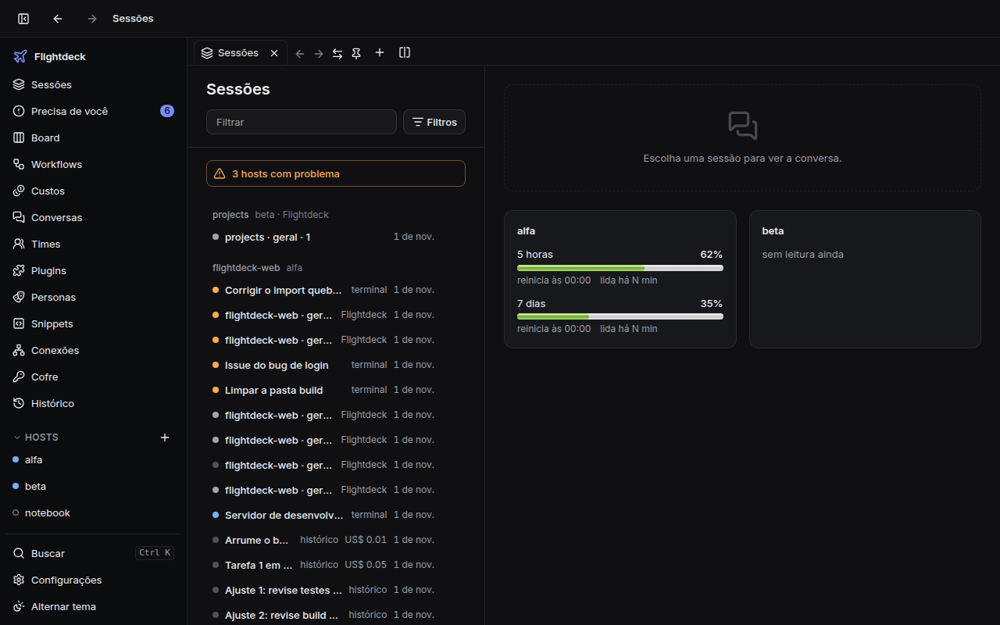
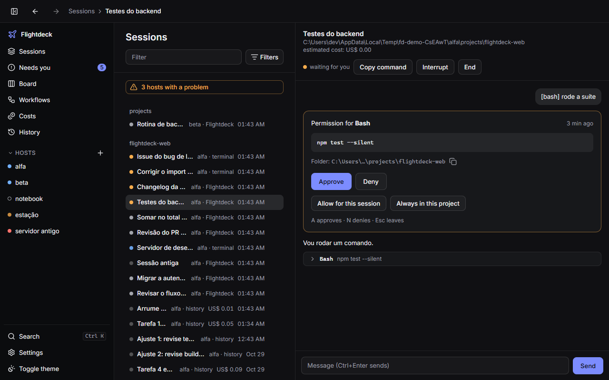
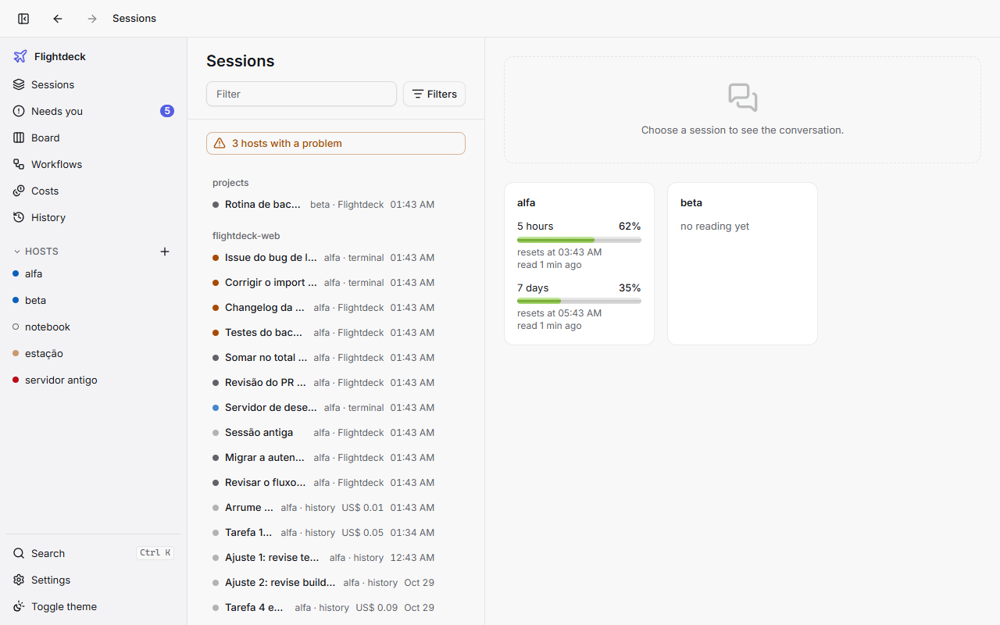
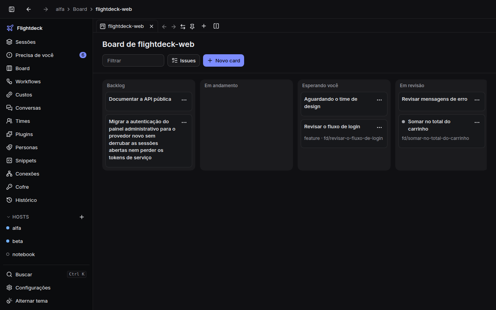
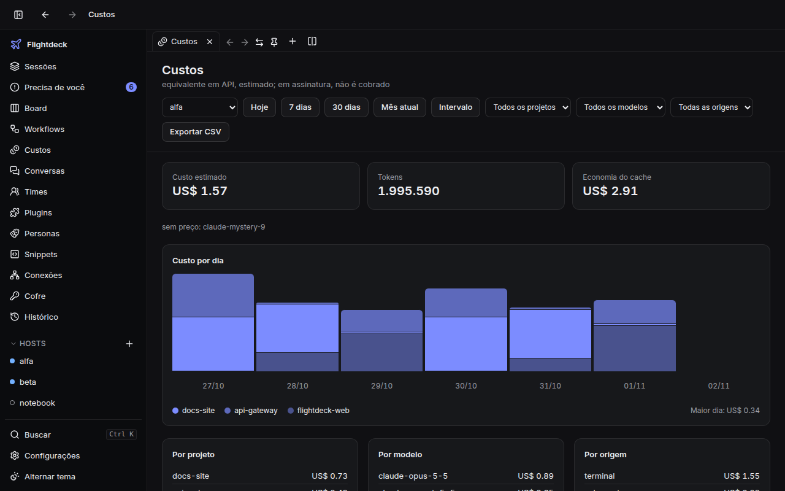

# Flightdeck

[English](README.md) | Português (Brasil)

[](https://github.com/jnerytech/flightdeck/actions/workflows/ci.yml)
[](LICENSE)
[](https://sonarcloud.io/summary/new_code?id=jnerytech_flightdeck)
[](https://sonarcloud.io/summary/new_code?id=jnerytech_flightdeck)
[](https://sonarcloud.io/summary/new_code?id=jnerytech_flightdeck)
[](https://sonarcloud.io/summary/new_code?id=jnerytech_flightdeck)
[](https://sonarcloud.io/summary/new_code?id=jnerytech_flightdeck)

**Um app desktop para ver, aprovar e conduzir todas as sessões do Claude Code de todas as suas máquinas.**

## O que é o Flightdeck

O Flightdeck é um app desktop (Tauri 2 + React, Windows em primeiro lugar) que centraliza as suas
sessões do Claude Code em vários hosts. Cada host roda um daemon pequeno, o `flightdeckd` (Bun +
TypeScript, SQLite, WebSocket), que hospeda sessões pelo Agent SDK oficial e acompanha as que você
abre num terminal. O app conecta em todos os daemons, e você acompanha, aprova e conversa com as
sessões num lugar só, sem abrir cada máquina.



## Recursos

**Sessões**

- Uma central para as sessões de todos os hosts, agrupadas por projeto, com o estado ao vivo e uma
  linha de resumo para cada uma.
- Sessões abertas num terminal também aparecem, por hooks do Claude Code que você instala se
  quiser.
- Aprove ou negue pedidos de ferramenta pelo app e mande mensagens para sessões do terminal abertas
  com `flightdeckd claude`.
- Regras de "permitir sempre" gravadas na config local do projeto no Claude Code, nunca na global.

**Trabalho**

- Um board por projeto: cada card é uma worktree git mais uma sessão, com pull requests no GitHub
  e no Azure DevOps.
- Workflows em YAML com agentes, checks, gates de aprovação, loops, etapas em paralelo e
  orçamentos.
- Busca no histórico de todos os hosts, inclusive de sessões que não nasceram no Flightdeck.
- Revisão do que uma sessão ou um card mudou: comente linhas do diff e envie a revisão ao agente,
  reverta ou edite arquivos, leve os comentários do PR ao agente e faça o merge local do card.
- Uma linha do tempo por sessão: volte aos arquivos de qualquer turno (com prévia e desfazer),
  bifurque a conversa a partir de um turno e edite os servidores MCP, o `CLAUDE.md`, os agentes e as
  skills do projeto. Voltar cobre só arquivos: não desfaz banco de dados, rede nem `git push`.
- Arquivos não rastreados (como `.env`) podem acompanhar um card até o worktree: liste-os em
  `.worktreeinclude` na raiz do repositório.
- Uma statusline do Claude Code com sua cota e custo: aponte `statusLine` para
  `flightdeckd statusline`. O Flightdeck nunca grava essa configuração; para manter uma statusline
  que você já tem, chame as duas em um só script e junte as linhas (veja o manual).

**Custo e cota**

- Custo estimado por projeto, modelo e origem, com exportação em CSV.
- Barras da cota do plano com a projeção de quando a janela esgota, fila por cota e orçamentos em
  US$ que avisam ou seguram cards novos.

**Desktop**

- Menu da bandeja para aprovar pedidos sem abrir a janela e paleta `Ctrl+K`.
- Atualização automática assinada, do app e dos daemons.
- Temas claro e escuro; português e inglês.

## Prints

| Aprovação, com "permitir sempre" | Tema claro |
| --- | --- |
|  |  |

| Board | Custos |
| --- | --- |
|  |  |

## Instalação

Baixe na página de [Releases](https://github.com/jnerytech/flightdeck/releases):

| Arquivo | O que é |
| --- | --- |
| `Flightdeck_<versão>_x64-setup.exe` (ou `.msi`) | o app desktop para Windows |
| `flightdeckd-windows-x64.exe`, `flightdeckd-linux-x64`, `flightdeckd-linux-arm64` | o daemon, um por host |
| `SHA256SUMS` | o SHA-256 de cada arquivo |

1. **Confira o download.** No Linux: `sha256sum -c SHA256SUMS --ignore-missing`. No Windows
   (PowerShell): `(Get-FileHash .\<arquivo>).Hash.ToLower()`, comparado com a linha do
   `SHA256SUMS`.
2. **Rode o instalador do app.** Ele não tem assinatura de código do Windows, então o SmartScreen
   mostra "O Windows protegeu o computador". Com o hash conferido, clique em **Mais informações** e
   depois em **Executar assim mesmo**.
3. **Instale o daemon em cada host**, com o Claude Code instalado e logado. Veja o Início rápido
   abaixo.

Para compilar a partir do código-fonte, veja o [manual](docs/manual/pt-BR.md#a-partir-do-código-fonte).

## Início rápido

1. **Instale o daemon como serviço** (no Linux, faça `chmod +x` no binário antes). No Windows, use
   `flightdeckd-windows-x64.exe` e `~\.flightdeck\bin\flightdeckd.exe`.

   ```sh
   ./flightdeckd-linux-x64 update --from ./flightdeckd-linux-x64   # instala em ~/.flightdeck/bin
   ~/.flightdeck/bin/flightdeckd service install
   ```

   Os comandos abaixo supõem `~/.flightdeck/bin` no seu `PATH`; senão, use o caminho completo
   (`~\.flightdeck\bin\flightdeckd.exe` no Windows). A primeira execução cria
   `~/.flightdeck/config.json`. Ponha em `allowedRoots` as pastas onde
   as sessões podem rodar (com a lista vazia nenhuma sessão pode ser criada) e reinicie:
   `flightdeckd service stop && flightdeckd service start`. Para um host que não seja esta
   máquina, defina também `bind` e `allowedNetworks`
   ([acesso remoto](docs/manual/pt-BR.md#acesso-remoto-pela-tailscale)).

2. **Pareie.** Imprima um link e um QR para o app:

   ```sh
   flightdeckd pair
   ```

3. **Adicione o host no app.** Clique em **Adicionar host**, cole o link `flightdeck://` e
   confirme com **Testar e adicionar**.

4. **Instale os hooks** (opt-in) para que as sessões do terminal apareçam. Você também pode usar o
   botão **Instalar hooks** na página do host, que dispensa o reinício:

   ```sh
   flightdeckd hooks install    # com o daemon já rodando, faça service stop / service start
   ```

5. **Abra o Claude Code pelo Flightdeck** para o app poder mandar mensagens para a sessão:

   ```sh
   flightdeckd claude          # mesmos argumentos do claude; alias sugerido: fd
   ```

## Como funciona

Cada host roda um `flightdeckd`. Ele abre sessões do Claude Code pelo Agent SDK, recebe eventos
dos hooks do Claude Code, indexa os transcripts do Claude Code que já existem no host e guarda
tudo num banco SQLite local. O app desktop abre um WebSocket por daemon e junta todos numa visão
só. Os hosts são independentes: nada é copiado entre eles.

```text
┌───────────────────────┐   WebSocket + token   ┌────────────────────────────────┐
│ App Flightdeck        │◄─────────────────────►│ flightdeckd, host A            │
│ (Tauri 2 + React)     │                       │  sessões pelo Agent SDK        │
│                       │                       │  receptor dos hooks do Claude  │
│  central · board ·    │   (pela Tailscale     │  índice do histórico (SQLite)  │
│  custos · bandeja     │    nos hosts remotos) │  worktrees git · PRs           │
│                       │                       └────────────────────────────────┘
│                       │◄─────────────────────►┌────────────────────────────────┐
└───────────────────────┘                       │ flightdeckd, host B  (igual)   │
                                                └────────────────────────────────┘
```

## Modelo de segurança

- **Um token por host.** O app conecta com um token aleatório, guardado no cofre de credenciais do
  sistema operacional. Tokens nunca aparecem nos logs, e `flightdeckd pair --rotate` troca o token.
- **Pastas.** Sessões só abrem dentro de `allowedRoots`; o caminho é resolvido com realpath, então
  `..` e symlinks que saem das raízes são recusados.
- **Redes.** Por padrão só conexões de loopback são aceitas. Qualquer outra origem exige uma
  entrada explícita em `allowedNetworks`, e expor a porta na internet aberta não é suportado.
- **Hooks opt-in.** A única escrita do Flightdeck em `~/.claude` são as entradas dos hooks, e só
  quando você pede (`flightdeckd hooks install`). Ele guarda uma cópia, e o `hooks uninstall` as
  remove. Os transcripts são só lidos. "Sempre neste projeto" grava no
  `.claude/settings.local.json` do próprio projeto, não no `~/.claude`.
- **Nada é aprovado sem um clique.** Os comandos `check` de um workflow só rodam se você confiou
  no workflow, e um arquivo alterado pede confiança de novo.
- **Atualizações assinadas.** O app e o daemon só instalam atualizações assinadas com a chave do
  projeto ([`release/flightdeck.pub`](release/flightdeck.pub)). O instalador do Windows em si não
  tem assinatura de código.

## Documentação

- Manual: [English](docs/manual/en.md) | [Português (Brasil)](docs/manual/pt-BR.md)
- Roadmap e specs: [`docs/SPEC.md`](docs/SPEC.md)
- Decisões e divergências em relação às specs: [`docs/DECISIONS.md`](docs/DECISIONS.md)

## Desenvolvimento

Pré-requisitos: [Bun](https://bun.sh) 1.4 ou mais novo e o Claude Code instalado e logado. Para o
app desktop, Rust estável e os
[pré-requisitos do Tauri 2](https://v2.tauri.app/start/prerequisites/).

```sh
bun install
bun run typecheck      # tsc em todos os workspaces e scripts
bun run lint           # Biome
bun run test           # testes com cobertura de 100% + confere que nenhum arquivo-fonte ficou de fora
bun run smoke          # ponta a ponta com o daemon real e o runtime fake
bun run build:daemon   # binários em dist/
bun run demo           # dois hosts de mentira e a entrada web do app, em http://localhost:1420
```

O desenvolvimento é test-first: o teste de cada área é commitado vermelho antes da implementação.
As regras estão em [`docs/TDD.md`](docs/TDD.md). Os outros smokes, o build e o fluxo de release
estão no [manual](docs/manual/pt-BR.md#desenvolvimento).

## Roadmap

O roadmap, com as fases já entregues, está no fim de [`docs/SPEC.md`](docs/SPEC.md).

## Licença

[MIT](LICENSE).
