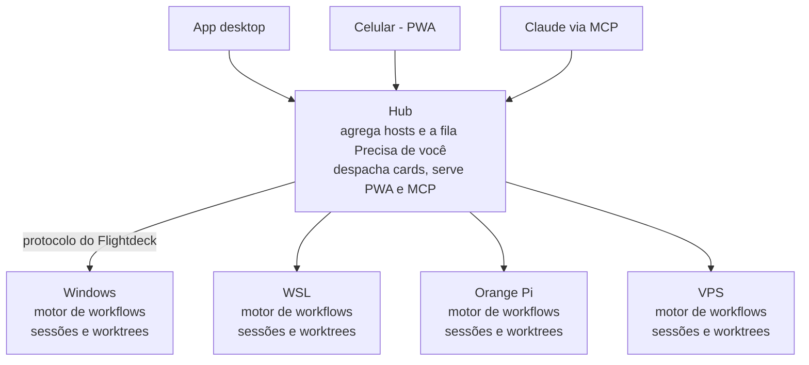

# Flightdeck — Spec da Fase 5 (Orquestrador)

## Objetivo e escopo

A Fase 5 troca "um card, uma sessão" por workflows: um card executa uma sequência de etapas (agentes, verificações e aprovações suas), distribuída entre os hosts, com orçamento e acesso pelo celular.

Pré-requisito: Fase 4 fechada.

**Dentro da Fase 5**

- Workflows declarados em YAML no próprio repositório.
- Motor de execução com etapas de agente, verificação, aprovação, repetição e paralelismo.
- Um daemon com papel de hub que agrega o estado de todos os hosts e despacha cards.
- Escolha de host por rótulos e capacidade.
- Servidor MCP do Flightdeck, para uma sessão do Claude criar cards e disparar workflows.
- Orçamento por execução (turnos, tempo, custo informado pelo SDK).
- App web progressivo (PWA) servido pelo hub, para acompanhar e aprovar pelo celular dentro da Tailscale.

**Fora da Fase 5**

- Agentes que não sejam o Claude Code.
- Voz.
- Agendamento por horário (cron) de workflows.
- Acesso fora da Tailscale e múltiplos usuários.

## Design

O workflow roda no daemon que tem a worktree do card; um daemon com papel de hub só escolhe o host, agrega o estado de todos e serve o celular e o MCP.



Cada card executa no worker onde está o repositório; o hub só escolhe o host, agrega e repassa.

### Workflows

Arquivos `.flightdeck/workflows/<nome>.yaml` no repositório, lidos da branch base. Exemplo:

```yaml
name: feature
inputs: [task]
budget: { maxTurns: 80, maxMinutes: 120, maxCostUsd: 15 }
steps:
  - id: plan
    agent:
      prompt: "Planeje a implementação de: {{inputs.task}}. Responda só com o plano."
      permissionMode: plan
  - id: approve-plan
    gate: { message: "Aprovar o plano?", show: "{{steps.plan.output}}" }
  - id: implement
    agent: { prompt: "Implemente este plano e faça commits:\n{{steps.plan.output}}" }
  - id: tests
    loop:
      max: 3
      until: { check: "bun test" }
      do:
        agent: { continue: implement, prompt: "Os testes falharam:\n{{loop.lastCheck.output}}\nCorrija." }
  - id: review
    parallel:
      - agent: { prompt: "Revise o diff com foco em segurança." }
      - agent: { prompt: "Revise o diff com foco em legibilidade." }
  - id: apply-review
    agent: { continue: implement, prompt: "Aplique o que fizer sentido destas revisões:\n{{steps.review.outputs}}" }
  - id: pr
    pr: {}
```

| Etapa | O que faz |
| --- | --- |
| `agent` | abre uma sessão na worktree do card; `continue: <id>` retoma a sessão de outra etapa; a saída é o último texto do assistente |
| `check` | roda um comando declarado no workflow, na worktree; a saída é código de retorno e as últimas 8 KB do output |
| `gate` | pausa a execução até você aprovar ou recusar, com nota opcional |
| `loop` | repete `do` até o `until` passar ou atingir `max`; estourou, vai para Esperando você |
| `parallel` | roda os itens ao mesmo tempo (respeitando a fila do host) e junta as saídas em `outputs` |
| `pr` | push e abertura do PR pelo provedor do projeto (Fase 4) |

Interpolação só com `{{inputs.*}}`, `{{steps.<id>.output}}`, `{{steps.<id>.outputs}}` e `{{loop.lastCheck.*}}`; referência desconhecida é erro de validação, não texto vazio.

### Confiança nos comandos

Etapas `check` executam shell, então cada workflow precisa ser aprovado por você antes da primeira execução. A aprovação guarda o hash do arquivo; se o arquivo mudar na base, volta a pedir aprovação. Workflows vindos da branch do próprio card nunca são usados.

### Motor de execução

- Estado persistido a cada transição; reiniciou o daemon, a execução retoma da etapa corrente (sessão com `resume`, `check` rodado de novo, `gate` continua aberto).
- O card segue as colunas da Fase 4, com mais duas regras: `gate` aberto leva a Esperando você, e a etapa `pr` leva a Em revisão.
- Orçamento somado de todas as sessões da execução: turnos, minutos de relógio e o custo que o SDK informa (em assinatura, é uma estimativa útil como teto). Estourou, a execução pausa em Esperando você com o motivo.
- **Custo é cumulativo por sessão.** O `costUsd` do `turn.result` vem do `total_cost_usd` do SDK, que é o total acumulado do processo da sessão, não o custo do turno. Guarde o último valor de cada sessão e some entre sessões; nunca some turno a turno. Uma sessão retomada com `resume` começa já com o total anterior: conte só a diferença em relação ao último valor conhecido.

### Hub

- Config `role: "hub"` e lista `workers` (nome, URL, token, rótulos). Os workers continuam daemons normais; ganham `labels` na própria config.
- O hub é cliente de cada worker pelo mesmo protocolo e repassa comandos e eventos para quem está conectado nele (app ou celular).
- **Despacho:** `card.create` no hub com o remoto do repositório e rótulos desejados escolhe, entre os workers que têm esse projeto cadastrado e os rótulos pedidos, o de mais vagas livres.

### MCP

O hub expõe um servidor MCP (via `@modelcontextprotocol/sdk`, numa versão compatível com a peer dependency do Agent SDK) por HTTP na tailnet, com o mesmo token, e o comando `flightdeckd mcp` oferece a versão stdio para o Claude Code local. Ferramentas: `list_hosts`, `list_projects`, `list_workflows`, `create_card`, `start_card`, `get_card`, `get_run`, `respond_gate`. Não há ferramenta para aprovar permissões: isso fica só com você.

### Dados

```sql
CREATE TABLE workflow_runs (id TEXT PRIMARY KEY, card_id TEXT, workflow_name TEXT, workflow_hash TEXT, status TEXT,
                            budget TEXT, usage TEXT, inputs TEXT, started_at TEXT, ended_at TEXT);
CREATE TABLE step_runs     (run_id TEXT, step_id TEXT, attempt INTEGER, type TEXT, status TEXT, session_id TEXT,
                            output TEXT, exit_code INTEGER, started_at TEXT, ended_at TEXT,
                            PRIMARY KEY (run_id, step_id, attempt));
CREATE TABLE trusted_workflows (project_id TEXT, name TEXT, hash TEXT, trusted_at TEXT,
                                PRIMARY KEY (project_id, name, hash));
```

### Protocolo (só adições)

| Item | Tipo | Conteúdo |
| --- | --- | --- |
| `workflow.list` / `workflow.validate` | comando | workflows do projeto e erros de validação |
| `workflow.trust` | comando | `projectId`, `name`, `hash` |
| `card.start` | comando | ganha `workflow?` e `inputs?` |
| `run.get` / `run.watch` | comando | estado da execução; passa a receber `run.updated` |
| `gate.respond` | comando | `runId`, `stepId`, `decision`, `note?` |
| `run.updated` | evento | execução com etapas, uso e orçamento |

## App desktop e celular

O desktop ganha a visão das execuções; o celular ganha um app enxuto, servido pelo hub, para aprovar e acompanhar.

**Código compartilhado:** os componentes de chat, aprovação, card e execução saem para `packages/ui`, usado pelo app desktop e pelo PWA. O PWA usa a implementação web da camada `platform` (Fase 2).

**Desktop**

- Ao iniciar um card: escolher o workflow e preencher os `inputs`.
- Linha do tempo da execução no detalhe do card: cada etapa com status, tentativa, duração e uso; clicar abre a conversa da sessão ou a saída do `check`.
- Card de gate inline, com Aprovar, Recusar e nota.
- Medidor de orçamento (turnos, minutos, custo estimado) por execução.
- Tela de workflows do projeto: validação, lista dos comandos `check` e o botão de confiar.
- Conexão ao hub ou direta a cada worker, à escolha.

**PWA no celular**

- Servido pelo hub em `/app`, exposto por `tailscale serve` para ter HTTPS, que é exigido para instalar o PWA e receber push.
- Telas: fila "Precisa de você" (permissões e gates de todos os hosts), aprovar ou negar, execuções ativas com a etapa corrente, conversa com envio de mensagem curta, e iniciar um card a partir de um workflow.
- Web Push: o hub gera as chaves VAPID e envia notificação em pedido de permissão, gate aberto, orçamento estourado e execução concluída ou com falha. O emissor é injetável; a biblioteca escolhida vai para `docs/DECISIONS.md`.
- `bun run build:pwa` gera o PWA a partir de `packages/ui`. A extração dos componentes para `packages/ui` é feita em commits `refactor` com a suíte verde, antes das telas novas.

## Disciplina TDD

Segue [`docs/TDD.md`](TDD.md): ciclo por área, travas e regras de evidência. A auditoria `bun run tdd:audit -- --since fase-4` (criada na Fase 2) confere a ordem dos commits e a ausência de testes desligados.

**Trava desta fase: comandos `check`.** Nos testes, etapas `check` só executam comandos falsos instalados pelo próprio teste (resolvidos com `whichOnPath`); o preload reprova a suíte se um `check` tentar rodar algo fora dessa lista.

## Testes, critérios e /goal

Tudo roda com o `FakeRuntime`, `check` falso configurável e `gh` falso, com todas as travas de `docs/TDD.md` e das fases anteriores ativas; o hub e os workers do smoke são processos locais em portas diferentes.

**Áreas de teste (cada uma entra no TDD e na auditoria)**

| Área | O que precisa passar |
| --- | --- |
| `workflow-schema` | YAML válido carrega; campo desconhecido, etapa sem `id` e referência inexistente em `{{…}}` são erros de validação |
| `interpolation` | `inputs`, `steps.<id>.output`, `steps.<id>.outputs` e `loop.lastCheck` resolvem; saída longa é cortada em 8 KB |
| `engine-agent` | etapa `agent` abre sessão na worktree; `continue` retoma a sessão da etapa indicada |
| `engine-check` | `check` grava código de retorno e saída; comando fora do workflow nunca roda |
| `engine-gate` | `gate` pausa e move o card para Esperando você; aprovado segue, recusado encerra a execução |
| `engine-loop` | repete até o `check` passar; estourou `max`, pausa com o motivo |
| `engine-parallel` | itens rodam juntos dentro da fila do host e as saídas chegam em `outputs` na ordem declarada |
| `engine-resume` | daemon reiniciado no meio de cada tipo de etapa retoma do ponto certo |
| `budget` | turnos e minutos somam entre sessões; o custo usa o último total de cada sessão (cumulativo) e só a diferença após `resume`; estouro pausa a execução |
| `trust` | workflow não confiado não roda; hash diferente pede nova confiança; workflow da branch do card é ignorado |
| `hub-dispatch` | card vai para o worker com o projeto, os rótulos pedidos e mais vagas |
| `hub-proxy` | comandos e eventos passam pelo hub nos dois sentidos, inclusive `permission.respond` e `gate.respond` |
| `mcp` | cada ferramenta responde pelo cliente MCP em processo; não existe ferramenta de permissão |
| `pwa` | as telas do celular rodam com a implementação web falsa da `platform`: fila "Precisa de você", aprovar ou negar, execuções ativas, conversa e iniciar card |
| `push` | os quatro gatilhos enviam um payload ao emissor de push falso |

**Smoke (`bun run smoke:workflow`)**

Começa vermelho, roda com as travas ativas, sobe um hub e dois workers `--runtime fake`, cadastra o mesmo projeto nos dois workers com rótulos diferentes, confia no workflow de exemplo, cria um card pelo hub pedindo um rótulo e confere o despacho. Executa o workflow inteiro: plano, gate aprovado pelo hub, implementação, `check` que falha uma vez e passa na segunda, revisão em paralelo e PR no `gh` falso, até o card chegar a Concluído. Imprime `SMOKE WORKFLOW OK`.

**Critérios de aceite**

- [ ] Para cada área da tabela acima, a conversa mostra o teste falhando por asserção antes da implementação e passando depois.
- [ ] `bun run tdd:audit -- --since fase-4` imprime `TDD AUDIT OK`.
- [ ] `bun run typecheck`, `bun run lint` e `bun test` saem com código 0, com cobertura de 100%.
- [ ] Todos os smokes anteriores continuam passando e `bun run smoke:workflow` imprime `SMOKE WORKFLOW OK`.
- [ ] `bun run build:daemon`, `bun run build:desktop` e `bun run build:pwa` saem com código 0, e `cargo check --manifest-path apps/desktop/src-tauri/Cargo.toml` também, no Windows nativo, se a casca Rust tiver mudado.
- [ ] README cobre workflows, confiança, hub, MCP e o PWA com `tailscale serve`.
- [ ] Divergências em `docs/DECISIONS.md`, `git status` limpo e a tag `fase-5` criada.

**Condição do /goal**

```text
/goal A Fase 5 de docs/SPEC-fase-5.md está implementada seguindo docs/TDD.md e, nesta conversa, você mostrou a saída real de: (1) para cada área da tabela de testes, o bun --config=bunfig.area.toml test do arquivo da área falhando por asserção antes da implementação e passando depois; (2) bun run tdd:audit -- --since fase-4 imprimindo TDD AUDIT OK; (3) bun run typecheck, bun run lint e bun test saindo com código 0; (4) bun run smoke, smoke:multi, smoke:history, smoke:board e smoke:workflow imprimindo SMOKE OK, SMOKE MULTI OK, SMOKE HISTORY OK, SMOKE BOARD OK e SMOKE WORKFLOW OK; (5) bun run build:daemon, build:desktop e build:pwa saindo com código 0, e cargo check saindo com código 0 no Windows nativo se src-tauri mudou; (6) git status sem alterações pendentes e git tag listando fase-5. Todas as rodadas de bun test e dos smokes rodaram com as travas do claude, de home, de CLIs e de comandos check ativas, e nenhum push foi para remoto que não fosse local.
```
