# Context map: the component picture, generated (issue #1624)

The C4 component level of [the context map](2026-11-10-context-map.md), drawn from the import graph
of the code: every file collapsed to its domain folder, an arrow where one domain imports another.
Generated by `bun run arch:picture`; do not edit it by hand. Run the command again after a move
and commit what it changes; an unchanged tree gives no diff.

## Daemon

```mermaid
flowchart LR
  daemon_account["account"]
  daemon_actions["actions"]
  daemon_activity["activity"]
  daemon_agentcfg["agentcfg"]
  daemon_assistant["assistant"]
  daemon_automations["automations"]
  daemon_bg["bg"]
  daemon_bin["bin"]
  daemon_board["board"]
  daemon_boardsync["boardsync"]
  daemon_central["central"]
  daemon_checkpoints["checkpoints"]
  daemon_cli["cli"]
  daemon_config["config"]
  daemon_costs["costs"]
  daemon_daemon_client["daemon-client"]
  daemon_deps["deps"]
  daemon_files["files"]
  daemon_github["github"]
  daemon_harness["harness"]
  daemon_history["history"]
  daemon_issues["issues"]
  daemon_kernel["kernel"]
  daemon_knowledge["knowledge"]
  daemon_logs["logs"]
  daemon_main["main"]
  daemon_maintenance["maintenance"]
  daemon_mcp["mcp"]
  daemon_memory["memory"]
  daemon_messaging["messaging"]
  daemon_names["names"]
  daemon_pairing["pairing"]
  daemon_permissions["permissions"]
  daemon_personas["personas"]
  daemon_plugins["plugins"]
  daemon_power["power"]
  daemon_projects["projects"]
  daemon_quota["quota"]
  daemon_releases["releases"]
  daemon_resources["resources"]
  daemon_review["review"]
  daemon_roi["roi"]
  daemon_runenv["runenv"]
  daemon_runtime["runtime"]
  daemon_server["server"]
  daemon_service["service"]
  daemon_sessions["sessions"]
  daemon_snippets["snippets"]
  daemon_ssh["ssh"]
  daemon_store["store"]
  daemon_summary["summary"]
  daemon_teams["teams"]
  daemon_telemetry["telemetry"]
  daemon_teleport["teleport"]
  daemon_templates["templates"]
  daemon_terminal["terminal"]
  daemon_text_modules_d["text-modules.d"]
  daemon_trace["trace"]
  daemon_trust["trust"]
  daemon_updates["updates"]
  daemon_vault["vault"]
  daemon_watch["watch"]
  daemon_webhook["webhook"]
  daemon_workflows["workflows"]
  daemon_worktrees["worktrees"]
  daemon_wsl["wsl"]
  protocol["protocol"]
  daemon_account --> daemon_quota
  daemon_account --> daemon_runtime
  daemon_actions --> daemon_board
  daemon_actions --> daemon_config
  daemon_actions --> daemon_daemon_client
  daemon_actions --> daemon_mcp
  daemon_actions --> daemon_vault
  daemon_agentcfg --> daemon_config
  daemon_assistant --> daemon_board
  daemon_assistant --> daemon_costs
  daemon_assistant --> daemon_permissions
  daemon_assistant --> daemon_quota
  daemon_assistant --> daemon_runtime
  daemon_assistant --> daemon_watch
  daemon_automations --> daemon_board
  daemon_automations --> daemon_boardsync
  daemon_automations --> daemon_config
  daemon_automations --> daemon_issues
  daemon_automations --> daemon_permissions
  daemon_automations --> daemon_quota
  daemon_automations --> daemon_server
  daemon_automations --> daemon_watch
  daemon_bg --> daemon_board
  daemon_bg --> daemon_config
  daemon_bin --> daemon_main
  daemon_board --> daemon_central
  daemon_board --> daemon_config
  daemon_board --> daemon_daemon_client
  daemon_board --> daemon_issues
  daemon_board --> daemon_permissions
  daemon_board --> daemon_personas
  daemon_board --> daemon_quota
  daemon_board --> daemon_roi
  daemon_board --> daemon_server
  daemon_board --> daemon_sessions
  daemon_board --> daemon_snippets
  daemon_board --> daemon_teleport
  daemon_board --> daemon_watch
  daemon_board --> daemon_workflows
  daemon_board --> daemon_worktrees
  daemon_boardsync --> daemon_board
  daemon_boardsync --> daemon_github
  daemon_boardsync --> daemon_issues
  daemon_boardsync --> daemon_quota
  daemon_central --> daemon_checkpoints
  daemon_central --> daemon_config
  daemon_central --> daemon_daemon_client
  daemon_central --> daemon_permissions
  daemon_central --> daemon_sessions
  daemon_central --> daemon_telemetry
  daemon_checkpoints --> daemon_history
  daemon_checkpoints --> daemon_personas
  daemon_checkpoints --> daemon_runtime
  daemon_checkpoints --> daemon_server
  daemon_checkpoints --> daemon_sessions
  daemon_cli --> daemon_actions
  daemon_cli --> daemon_board
  daemon_cli --> daemon_central
  daemon_cli --> daemon_config
  daemon_cli --> daemon_costs
  daemon_cli --> daemon_daemon_client
  daemon_cli --> daemon_deps
  daemon_cli --> daemon_history
  daemon_cli --> daemon_maintenance
  daemon_cli --> daemon_mcp
  daemon_cli --> daemon_messaging
  daemon_cli --> daemon_pairing
  daemon_cli --> daemon_permissions
  daemon_cli --> daemon_runtime
  daemon_cli --> daemon_service
  daemon_cli --> daemon_ssh
  daemon_cli --> daemon_store
  daemon_cli --> daemon_telemetry
  daemon_cli --> daemon_templates
  daemon_cli --> daemon_wsl
  daemon_config --> daemon_costs
  daemon_config --> daemon_permissions
  daemon_config --> daemon_runenv
  daemon_config --> daemon_wsl
  daemon_costs --> daemon_config
  daemon_costs --> daemon_daemon_client
  daemon_costs --> daemon_history
  daemon_costs --> daemon_quota
  daemon_costs --> daemon_server
  daemon_deps --> daemon_central
  daemon_deps --> daemon_config
  daemon_deps --> daemon_mcp
  daemon_deps --> daemon_pairing
  daemon_deps --> daemon_runtime
  daemon_deps --> daemon_server
  daemon_deps --> daemon_service
  daemon_deps --> daemon_templates
  daemon_github --> daemon_board
  daemon_github --> daemon_config
  daemon_github --> daemon_issues
  daemon_github --> daemon_projects
  daemon_harness --> daemon_board
  daemon_harness --> daemon_config
  daemon_harness --> daemon_quota
  daemon_harness --> daemon_runtime
  daemon_harness --> daemon_server
  daemon_history --> daemon_config
  daemon_history --> daemon_names
  daemon_history --> daemon_permissions
  daemon_history --> daemon_server
  daemon_issues --> daemon_board
  daemon_issues --> daemon_central
  daemon_issues --> daemon_permissions
  daemon_knowledge --> daemon_agentcfg
  daemon_knowledge --> daemon_config
  daemon_knowledge --> daemon_permissions
  daemon_knowledge --> daemon_server
  daemon_logs --> daemon_vault
  daemon_main --> daemon_account
  daemon_main --> daemon_actions
  daemon_main --> daemon_activity
  daemon_main --> daemon_assistant
  daemon_main --> daemon_automations
  daemon_main --> daemon_bg
  daemon_main --> daemon_board
  daemon_main --> daemon_central
  daemon_main --> daemon_checkpoints
  daemon_main --> daemon_cli
  daemon_main --> daemon_config
  daemon_main --> daemon_costs
  daemon_main --> daemon_deps
  daemon_main --> daemon_github
  daemon_main --> daemon_harness
  daemon_main --> daemon_history
  daemon_main --> daemon_knowledge
  daemon_main --> daemon_logs
  daemon_main --> daemon_maintenance
  daemon_main --> daemon_memory
  daemon_main --> daemon_names
  daemon_main --> daemon_permissions
  daemon_main --> daemon_personas
  daemon_main --> daemon_plugins
  daemon_main --> daemon_power
  daemon_main --> daemon_projects
  daemon_main --> daemon_quota
  daemon_main --> daemon_releases
  daemon_main --> daemon_resources
  daemon_main --> daemon_review
  daemon_main --> daemon_roi
  daemon_main --> daemon_runenv
  daemon_main --> daemon_runtime
  daemon_main --> daemon_server
  daemon_main --> daemon_service
  daemon_main --> daemon_sessions
  daemon_main --> daemon_snippets
  daemon_main --> daemon_ssh
  daemon_main --> daemon_store
  daemon_main --> daemon_summary
  daemon_main --> daemon_teams
  daemon_main --> daemon_telemetry
  daemon_main --> daemon_teleport
  daemon_main --> daemon_terminal
  daemon_main --> daemon_trace
  daemon_main --> daemon_trust
  daemon_main --> daemon_updates
  daemon_main --> daemon_watch
  daemon_main --> daemon_webhook
  daemon_main --> daemon_workflows
  daemon_main --> daemon_worktrees
  daemon_main --> daemon_wsl
  daemon_maintenance --> daemon_config
  daemon_maintenance --> daemon_server
  daemon_maintenance --> daemon_store
  daemon_mcp --> daemon_daemon_client
  daemon_mcp --> daemon_messaging
  daemon_memory --> daemon_agentcfg
  daemon_memory --> daemon_config
  daemon_messaging --> daemon_central
  daemon_messaging --> daemon_daemon_client
  daemon_messaging --> daemon_history
  daemon_messaging --> daemon_issues
  daemon_messaging --> daemon_names
  daemon_messaging --> daemon_permissions
  daemon_messaging --> daemon_sessions
  daemon_pairing --> daemon_config
  daemon_permissions --> daemon_assistant
  daemon_permissions --> daemon_central
  daemon_permissions --> daemon_config
  daemon_permissions --> daemon_costs
  daemon_permissions --> daemon_runtime
  daemon_permissions --> daemon_store
  daemon_personas --> daemon_agentcfg
  daemon_personas --> daemon_central
  daemon_personas --> daemon_sessions
  daemon_personas --> daemon_snippets
  daemon_plugins --> daemon_agentcfg
  daemon_plugins --> daemon_memory
  daemon_plugins --> daemon_templates
  daemon_power --> daemon_config
  daemon_power --> daemon_server
  daemon_power --> daemon_wsl
  daemon_projects --> daemon_config
  daemon_quota --> daemon_config
  daemon_quota --> daemon_runtime
  daemon_quota --> daemon_server
  daemon_resources --> daemon_config
  daemon_resources --> daemon_quota
  daemon_resources --> daemon_server
  daemon_review --> daemon_board
  daemon_review --> daemon_central
  daemon_review --> daemon_costs
  daemon_review --> daemon_history
  daemon_review --> daemon_permissions
  daemon_review --> daemon_personas
  daemon_review --> daemon_quota
  daemon_review --> daemon_runtime
  daemon_review --> daemon_server
  daemon_review --> daemon_sessions
  daemon_runenv --> daemon_board
  daemon_runenv --> daemon_server
  daemon_runenv --> daemon_terminal
  daemon_runenv --> daemon_workflows
  daemon_runtime --> daemon_config
  daemon_runtime --> daemon_costs
  daemon_runtime --> daemon_permissions
  daemon_runtime --> daemon_quota
  daemon_server --> daemon_account
  daemon_server --> daemon_actions
  daemon_server --> daemon_activity
  daemon_server --> daemon_agentcfg
  daemon_server --> daemon_assistant
  daemon_server --> daemon_automations
  daemon_server --> daemon_bg
  daemon_server --> daemon_board
  daemon_server --> daemon_boardsync
  daemon_server --> daemon_central
  daemon_server --> daemon_checkpoints
  daemon_server --> daemon_config
  daemon_server --> daemon_costs
  daemon_server --> daemon_files
  daemon_server --> daemon_github
  daemon_server --> daemon_harness
  daemon_server --> daemon_history
  daemon_server --> daemon_issues
  daemon_server --> daemon_knowledge
  daemon_server --> daemon_logs
  daemon_server --> daemon_maintenance
  daemon_server --> daemon_memory
  daemon_server --> daemon_messaging
  daemon_server --> daemon_names
  daemon_server --> daemon_permissions
  daemon_server --> daemon_personas
  daemon_server --> daemon_plugins
  daemon_server --> daemon_projects
  daemon_server --> daemon_quota
  daemon_server --> daemon_releases
  daemon_server --> daemon_resources
  daemon_server --> daemon_review
  daemon_server --> daemon_roi
  daemon_server --> daemon_runenv
  daemon_server --> daemon_runtime
  daemon_server --> daemon_sessions
  daemon_server --> daemon_snippets
  daemon_server --> daemon_ssh
  daemon_server --> daemon_summary
  daemon_server --> daemon_teams
  daemon_server --> daemon_telemetry
  daemon_server --> daemon_teleport
  daemon_server --> daemon_templates
  daemon_server --> daemon_terminal
  daemon_server --> daemon_trace
  daemon_server --> daemon_trust
  daemon_server --> daemon_updates
  daemon_server --> daemon_vault
  daemon_server --> daemon_watch
  daemon_server --> daemon_webhook
  daemon_server --> daemon_workflows
  daemon_server --> daemon_worktrees
  daemon_service --> daemon_central
  daemon_service --> daemon_config
  daemon_service --> daemon_wsl
  daemon_sessions --> daemon_central
  daemon_sessions --> daemon_config
  daemon_sessions --> daemon_permissions
  daemon_sessions --> daemon_personas
  daemon_sessions --> daemon_runtime
  daemon_sessions --> daemon_server
  daemon_sessions --> daemon_store
  daemon_sessions --> daemon_worktrees
  daemon_snippets --> daemon_central
  daemon_snippets --> daemon_config
  daemon_snippets --> daemon_sessions
  daemon_snippets --> daemon_terminal
  daemon_ssh --> daemon_actions
  daemon_ssh --> daemon_config
  daemon_ssh --> daemon_costs
  daemon_ssh --> daemon_daemon_client
  daemon_ssh --> daemon_quota
  daemon_ssh --> daemon_terminal
  daemon_store --> daemon_personas
  daemon_summary --> daemon_history
  daemon_teams --> daemon_board
  daemon_teams --> daemon_central
  daemon_teams --> daemon_config
  daemon_teams --> daemon_messaging
  daemon_teams --> daemon_names
  daemon_teams --> daemon_personas
  daemon_teams --> daemon_quota
  daemon_teams --> daemon_server
  daemon_teams --> daemon_sessions
  daemon_telemetry --> daemon_central
  daemon_telemetry --> daemon_config
  daemon_telemetry --> daemon_server
  daemon_teleport --> daemon_board
  daemon_teleport --> daemon_server
  daemon_terminal --> daemon_central
  daemon_terminal --> daemon_config
  daemon_terminal --> daemon_quota
  daemon_terminal --> daemon_server
  daemon_terminal --> daemon_service
  daemon_terminal --> daemon_worktrees
  daemon_trace --> daemon_telemetry
  daemon_trust --> daemon_config
  daemon_trust --> daemon_server
  daemon_updates --> daemon_config
  daemon_updates --> daemon_quota
  daemon_updates --> daemon_server
  daemon_updates --> daemon_service
  daemon_vault --> daemon_config
  daemon_watch --> daemon_board
  daemon_watch --> daemon_issues
  daemon_watch --> daemon_snippets
  daemon_watch --> daemon_workflows
  daemon_webhook --> daemon_vault
  daemon_workflows --> daemon_board
  daemon_workflows --> daemon_personas
  daemon_workflows --> daemon_sessions
  daemon_worktrees --> daemon_board
  daemon_worktrees --> daemon_permissions
  daemon_wsl --> daemon_config
```

Imported by more than 40 domains, so their edges are not drawn: `kernel`, `protocol`.

## Desktop

```mermaid
flowchart LR
  desktop_account["account"]
  desktop_actions["actions"]
  desktop_activity["activity"]
  desktop_agentcfg["agentcfg"]
  desktop_app["app"]
  desktop_appupdate["appupdate"]
  desktop_assistant["assistant"]
  desktop_automations["automations"]
  desktop_background["background"]
  desktop_backup["backup"]
  desktop_board["board"]
  desktop_checkpoints["checkpoints"]
  desktop_clients["clients"]
  desktop_components["components"]
  desktop_costs["costs"]
  desktop_demo["demo"]
  desktop_deps["deps"]
  desktop_files["files"]
  desktop_harness["harness"]
  desktop_history["history"]
  desktop_home["home"]
  desktop_hooks["hooks"]
  desktop_hosts["hosts"]
  desktop_i18n["i18n"]
  desktop_inbox["inbox"]
  desktop_issues["issues"]
  desktop_knowledge["knowledge"]
  desktop_lib["lib"]
  desktop_main["main"]
  desktop_main_web["main.web"]
  desktop_maintenance["maintenance"]
  desktop_memory["memory"]
  desktop_messaging["messaging"]
  desktop_needs_you["needs-you"]
  desktop_notifications["notifications"]
  desktop_palette["palette"]
  desktop_permissions["permissions"]
  desktop_personas["personas"]
  desktop_platform["platform"]
  desktop_plugins["plugins"]
  desktop_projects["projects"]
  desktop_quota["quota"]
  desktop_review["review"]
  desktop_roi["roi"]
  desktop_runenv["runenv"]
  desktop_sessions["sessions"]
  desktop_settings["settings"]
  desktop_setup["setup"]
  desktop_shared["shared"]
  desktop_shell["shell"]
  desktop_shortcuts["shortcuts"]
  desktop_snippets["snippets"]
  desktop_ssh["ssh"]
  desktop_styles_css["styles.css"]
  desktop_summary["summary"]
  desktop_tabs["tabs"]
  desktop_teams["teams"]
  desktop_telemetry["telemetry"]
  desktop_teleport["teleport"]
  desktop_terminal["terminal"]
  desktop_trace["trace"]
  desktop_tray["tray"]
  desktop_trust["trust"]
  desktop_ui["ui"]
  desktop_vault["vault"]
  desktop_viewprefs["viewprefs"]
  desktop_vite_env_d["vite-env.d"]
  desktop_watch["watch"]
  desktop_webhook["webhook"]
  desktop_workflows["workflows"]
  protocol["protocol"]
  desktop_actions --> desktop_hooks
  desktop_actions --> desktop_snippets
  desktop_actions --> desktop_ssh
  desktop_actions --> desktop_vault
  desktop_activity --> desktop_hooks
  desktop_activity --> desktop_permissions
  desktop_activity --> desktop_sessions
  desktop_agentcfg --> desktop_hooks
  desktop_agentcfg --> desktop_memory
  desktop_agentcfg --> desktop_personas
  desktop_appupdate --> desktop_platform
  desktop_assistant --> desktop_platform
  desktop_assistant --> desktop_sessions
  desktop_assistant --> desktop_shortcuts
  desktop_automations --> desktop_hooks
  desktop_background --> desktop_costs
  desktop_backup --> desktop_hooks
  desktop_backup --> desktop_hosts
  desktop_backup --> desktop_platform
  desktop_backup --> desktop_vault
  desktop_board --> desktop_assistant
  desktop_board --> desktop_costs
  desktop_board --> desktop_files
  desktop_board --> desktop_hooks
  desktop_board --> desktop_issues
  desktop_board --> desktop_needs_you
  desktop_board --> desktop_personas
  desktop_board --> desktop_platform
  desktop_board --> desktop_projects
  desktop_board --> desktop_quota
  desktop_board --> desktop_review
  desktop_board --> desktop_roi
  desktop_board --> desktop_runenv
  desktop_board --> desktop_sessions
  desktop_board --> desktop_shortcuts
  desktop_board --> desktop_terminal
  desktop_board --> desktop_watch
  desktop_board --> desktop_workflows
  desktop_checkpoints --> desktop_sessions
  desktop_checkpoints --> desktop_terminal
  desktop_clients --> desktop_costs
  desktop_clients --> desktop_personas
  desktop_clients --> desktop_platform
  desktop_clients --> desktop_roi
  desktop_clients --> desktop_sessions
  desktop_clients --> desktop_vault
  desktop_components --> desktop_app
  desktop_components --> desktop_hooks
  desktop_costs --> desktop_clients
  desktop_costs --> desktop_hooks
  desktop_costs --> desktop_hosts
  desktop_costs --> desktop_platform
  desktop_costs --> desktop_quota
  desktop_costs --> desktop_roi
  desktop_costs --> desktop_sessions
  desktop_costs --> desktop_shell
  desktop_demo --> desktop_hosts
  desktop_demo --> desktop_platform
  desktop_demo --> desktop_shell
  desktop_files --> desktop_board
  desktop_files --> desktop_review
  desktop_files --> desktop_sessions
  desktop_history --> desktop_costs
  desktop_history --> desktop_hooks
  desktop_history --> desktop_sessions
  desktop_history --> desktop_shell
  desktop_home --> desktop_assistant
  desktop_home --> desktop_clients
  desktop_home --> desktop_costs
  desktop_home --> desktop_hooks
  desktop_home --> desktop_hosts
  desktop_home --> desktop_permissions
  desktop_home --> desktop_platform
  desktop_home --> desktop_projects
  desktop_home --> desktop_sessions
  desktop_home --> desktop_shell
  desktop_hooks --> desktop_board
  desktop_hooks --> desktop_costs
  desktop_hooks --> desktop_projects
  desktop_hooks --> desktop_sessions
  desktop_hooks --> desktop_tabs
  desktop_hosts --> desktop_account
  desktop_hosts --> desktop_costs
  desktop_hosts --> desktop_deps
  desktop_hosts --> desktop_harness
  desktop_hosts --> desktop_home
  desktop_hosts --> desktop_hooks
  desktop_hosts --> desktop_maintenance
  desktop_hosts --> desktop_projects
  desktop_hosts --> desktop_sessions
  desktop_hosts --> desktop_shell
  desktop_hosts --> desktop_tabs
  desktop_hosts --> desktop_telemetry
  desktop_hosts --> desktop_terminal
  desktop_i18n --> desktop_platform
  desktop_inbox --> desktop_notifications
  desktop_inbox --> desktop_permissions
  desktop_inbox --> desktop_platform
  desktop_inbox --> desktop_sessions
  desktop_issues --> desktop_hooks
  desktop_lib --> desktop_account
  desktop_lib --> desktop_activity
  desktop_lib --> desktop_app
  desktop_lib --> desktop_appupdate
  desktop_lib --> desktop_assistant
  desktop_lib --> desktop_background
  desktop_lib --> desktop_backup
  desktop_lib --> desktop_board
  desktop_lib --> desktop_clients
  desktop_lib --> desktop_costs
  desktop_lib --> desktop_history
  desktop_lib --> desktop_home
  desktop_lib --> desktop_hosts
  desktop_lib --> desktop_inbox
  desktop_lib --> desktop_messaging
  desktop_lib --> desktop_needs_you
  desktop_lib --> desktop_notifications
  desktop_lib --> desktop_permissions
  desktop_lib --> desktop_personas
  desktop_lib --> desktop_platform
  desktop_lib --> desktop_projects
  desktop_lib --> desktop_quota
  desktop_lib --> desktop_roi
  desktop_lib --> desktop_sessions
  desktop_lib --> desktop_settings
  desktop_lib --> desktop_shell
  desktop_lib --> desktop_snippets
  desktop_lib --> desktop_ssh
  desktop_lib --> desktop_tabs
  desktop_lib --> desktop_teleport
  desktop_lib --> desktop_terminal
  desktop_lib --> desktop_tray
  desktop_lib --> desktop_vault
  desktop_lib --> desktop_viewprefs
  desktop_lib --> desktop_watch
  desktop_lib --> desktop_webhook
  desktop_main --> desktop_platform
  desktop_main --> desktop_styles_css
  desktop_main --> desktop_ui
  desktop_main_web --> desktop_demo
  desktop_main_web --> desktop_platform
  desktop_main_web --> desktop_styles_css
  desktop_main_web --> desktop_ui
  desktop_messaging --> desktop_clients
  desktop_messaging --> desktop_hooks
  desktop_messaging --> desktop_sessions
  desktop_needs_you --> desktop_activity
  desktop_needs_you --> desktop_clients
  desktop_needs_you --> desktop_costs
  desktop_needs_you --> desktop_messaging
  desktop_needs_you --> desktop_permissions
  desktop_needs_you --> desktop_platform
  desktop_needs_you --> desktop_sessions
  desktop_needs_you --> desktop_shortcuts
  desktop_needs_you --> desktop_watch
  desktop_notifications --> desktop_platform
  desktop_palette --> desktop_clients
  desktop_palette --> desktop_history
  desktop_palette --> desktop_hosts
  desktop_palette --> desktop_sessions
  desktop_palette --> desktop_shortcuts
  desktop_palette --> desktop_snippets
  desktop_palette --> desktop_terminal
  desktop_permissions --> desktop_hooks
  desktop_permissions --> desktop_vault
  desktop_personas --> desktop_assistant
  desktop_personas --> desktop_hooks
  desktop_personas --> desktop_platform
  desktop_plugins --> desktop_hosts
  desktop_projects --> desktop_assistant
  desktop_projects --> desktop_costs
  desktop_projects --> desktop_hooks
  desktop_projects --> desktop_hosts
  desktop_projects --> desktop_knowledge
  desktop_projects --> desktop_permissions
  desktop_projects --> desktop_personas
  desktop_projects --> desktop_sessions
  desktop_projects --> desktop_shell
  desktop_projects --> desktop_shortcuts
  desktop_projects --> desktop_terminal
  desktop_projects --> desktop_trust
  desktop_review --> desktop_assistant
  desktop_roi --> desktop_costs
  desktop_roi --> desktop_platform
  desktop_roi --> desktop_sessions
  desktop_runenv --> desktop_costs
  desktop_runenv --> desktop_hooks
  desktop_runenv --> desktop_permissions
  desktop_sessions --> desktop_assistant
  desktop_sessions --> desktop_background
  desktop_sessions --> desktop_board
  desktop_sessions --> desktop_checkpoints
  desktop_sessions --> desktop_clients
  desktop_sessions --> desktop_costs
  desktop_sessions --> desktop_deps
  desktop_sessions --> desktop_files
  desktop_sessions --> desktop_history
  desktop_sessions --> desktop_hooks
  desktop_sessions --> desktop_hosts
  desktop_sessions --> desktop_inbox
  desktop_sessions --> desktop_messaging
  desktop_sessions --> desktop_notifications
  desktop_sessions --> desktop_permissions
  desktop_sessions --> desktop_personas
  desktop_sessions --> desktop_platform
  desktop_sessions --> desktop_projects
  desktop_sessions --> desktop_review
  desktop_sessions --> desktop_shell
  desktop_sessions --> desktop_shortcuts
  desktop_sessions --> desktop_snippets
  desktop_sessions --> desktop_summary
  desktop_sessions --> desktop_telemetry
  desktop_sessions --> desktop_teleport
  desktop_sessions --> desktop_terminal
  desktop_sessions --> desktop_trace
  desktop_sessions --> desktop_watch
  desktop_settings --> desktop_appupdate
  desktop_settings --> desktop_assistant
  desktop_settings --> desktop_backup
  desktop_settings --> desktop_costs
  desktop_settings --> desktop_messaging
  desktop_settings --> desktop_notifications
  desktop_settings --> desktop_platform
  desktop_settings --> desktop_sessions
  desktop_settings --> desktop_shell
  desktop_settings --> desktop_shortcuts
  desktop_settings --> desktop_tabs
  desktop_settings --> desktop_terminal
  desktop_settings --> desktop_watch
  desktop_settings --> desktop_webhook
  desktop_shared --> desktop_hooks
  desktop_shell --> desktop_clients
  desktop_shell --> desktop_costs
  desktop_shell --> desktop_deps
  desktop_shell --> desktop_hooks
  desktop_shell --> desktop_hosts
  desktop_shell --> desktop_needs_you
  desktop_shell --> desktop_platform
  desktop_shell --> desktop_projects
  desktop_shell --> desktop_quota
  desktop_shell --> desktop_sessions
  desktop_shell --> desktop_shortcuts
  desktop_shell --> desktop_tabs
  desktop_snippets --> desktop_assistant
  desktop_snippets --> desktop_clients
  desktop_snippets --> desktop_hooks
  desktop_snippets --> desktop_platform
  desktop_ssh --> desktop_hooks
  desktop_ssh --> desktop_vault
  desktop_summary --> desktop_costs
  desktop_summary --> desktop_sessions
  desktop_tabs --> desktop_hooks
  desktop_tabs --> desktop_hosts
  desktop_tabs --> desktop_platform
  desktop_tabs --> desktop_sessions
  desktop_tabs --> desktop_shell
  desktop_tabs --> desktop_ssh
  desktop_teams --> desktop_assistant
  desktop_teams --> desktop_hooks
  desktop_teams --> desktop_personas
  desktop_teams --> desktop_projects
  desktop_teams --> desktop_sessions
  desktop_telemetry --> desktop_costs
  desktop_telemetry --> desktop_sessions
  desktop_teleport --> desktop_hosts
  desktop_teleport --> desktop_terminal
  desktop_terminal --> desktop_files
  desktop_terminal --> desktop_personas
  desktop_terminal --> desktop_platform
  desktop_terminal --> desktop_sessions
  desktop_terminal --> desktop_shell
  desktop_terminal --> desktop_snippets
  desktop_trace --> desktop_costs
  desktop_trace --> desktop_sessions
  desktop_tray --> desktop_platform
  desktop_tray --> desktop_sessions
  desktop_trust --> desktop_harness
  desktop_trust --> desktop_sessions
  desktop_ui --> desktop_actions
  desktop_ui --> desktop_activity
  desktop_ui --> desktop_agentcfg
  desktop_ui --> desktop_appupdate
  desktop_ui --> desktop_automations
  desktop_ui --> desktop_board
  desktop_ui --> desktop_checkpoints
  desktop_ui --> desktop_clients
  desktop_ui --> desktop_costs
  desktop_ui --> desktop_history
  desktop_ui --> desktop_home
  desktop_ui --> desktop_hooks
  desktop_ui --> desktop_hosts
  desktop_ui --> desktop_inbox
  desktop_ui --> desktop_messaging
  desktop_ui --> desktop_needs_you
  desktop_ui --> desktop_palette
  desktop_ui --> desktop_permissions
  desktop_ui --> desktop_personas
  desktop_ui --> desktop_plugins
  desktop_ui --> desktop_projects
  desktop_ui --> desktop_quota
  desktop_ui --> desktop_runenv
  desktop_ui --> desktop_sessions
  desktop_ui --> desktop_settings
  desktop_ui --> desktop_setup
  desktop_ui --> desktop_shell
  desktop_ui --> desktop_shortcuts
  desktop_ui --> desktop_snippets
  desktop_ui --> desktop_ssh
  desktop_ui --> desktop_summary
  desktop_ui --> desktop_tabs
  desktop_ui --> desktop_teams
  desktop_ui --> desktop_terminal
  desktop_ui --> desktop_trust
  desktop_ui --> desktop_vault
  desktop_ui --> desktop_workflows
  desktop_vault --> desktop_backup
  desktop_vault --> desktop_clients
  desktop_vault --> desktop_hooks
  desktop_vault --> desktop_permissions
  desktop_vault --> desktop_platform
  desktop_viewprefs --> desktop_board
  desktop_viewprefs --> desktop_sessions
  desktop_viewprefs --> desktop_shell
  desktop_watch --> desktop_assistant
  desktop_watch --> desktop_notifications
  desktop_watch --> desktop_sessions
  desktop_webhook --> desktop_hooks
  desktop_webhook --> desktop_platform
```

Imported by more than 40 domains, so their edges are not drawn: `components`, `i18n`, `lib`, `shared`, `protocol`.
