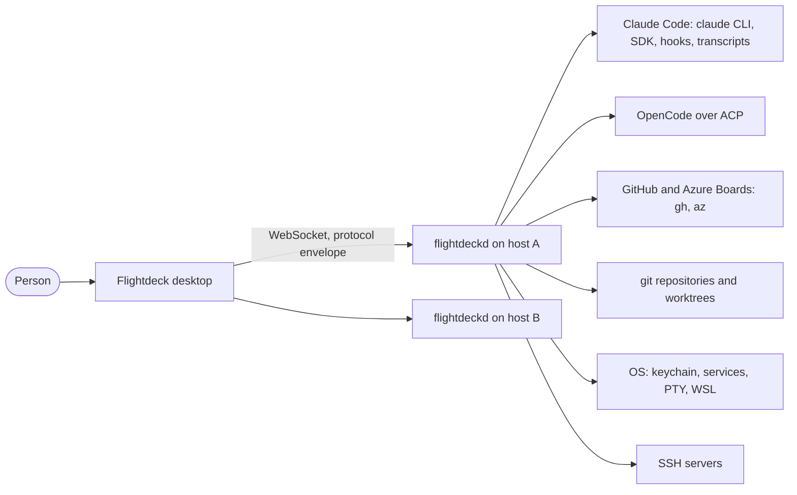

# Context map: the domains of the daemon, the desktop and the protocol (issue #1600)

The domain map and its words before any folder moves (Evans: bounded contexts, ubiquitous
language), drawn as C4 levels (Simon Brown). It records the code as it stood on 2026-11-10
(main at `b63d23556`) and the border each move works toward. The rules are in the root
`CLAUDE.md` ("Structure") and `docs/decisions/2026-11-09-domain-modules.md`.

## Level 1: context

## Level 2: containers

| Container | Tech | Owns |
| --- | --- | --- |
| `apps/desktop` | Tauri 2 (Rust in `src-tauri/`) and React 19 | The screens, one store per app, the hosts it is paired with |
| `apps/daemon` (`flightdeckd`) | Bun, SQLite, WebSocket | Everything that happens on a host: sessions, boards, secrets, files |
| `packages/protocol` | zod schemas and types | The envelope and every message between the two: the shared kernel |

The desktop never talks to Claude Code, git or GitHub directly: every effect on a host goes through
its daemon. The protocol is the only code both apps import.

## Level 3: components (the bounded contexts of the daemon)

Each row is one bounded context; its folders are listed in `docs/GLOSSARY.md` ("Domains"). The
picture of this level is generated from the code by dependency-cruiser and committed with #1591,
so it is regenerated rather than drawn by hand.

| Context | Folders | Kind | Owns |
| --- | --- | --- | --- |
| Session | `sessions`, `runtime`, `central`, `bg`, `names`, `checkpoints`, `teleport`, `summary` | core | A session from start to end, whoever runs it (SDK, OpenCode, terminal, background) |
| Board | `board`, `workflows`, `watch`, `worktrees`, `runenv`, `review`, `automations` | core | Cards, their steps, branches, PRs and run environments |
| Permission | `permissions`, `trust` | core | What a session may do, who decided, and what a project would load |
| Work trackers | `issues`, `github`, `boardsync` | supporting, anti-corruption | GitHub and Azure Boards, translated into issues, PR states and cards |
| Agent setup | `agentcfg`, `memory`, `plugins`, `personas`, `snippets`, `harness`, `knowledge`, `templates` | supporting | What a session starts with: configuration, roles, prompts, documents |
| Collaboration | `messaging`, `teams` | supporting | Sessions that talk to each other and teams of them |
| Secrets | `vault`, `actions`, `ssh`, `webhook` | supporting | Secrets and the commands that use them without showing them |
| Usage | `quota`, `account`, `costs`, `roi`, `resources` | supporting | What the work uses and what it is worth |
| Observation | `history`, `trace`, `telemetry`, `activity` | read model | What already happened, read from transcripts, OTLP and the daemon's own records |
| Assistant | `assistant` | supporting | The host's assistant for requests, commits and PR texts |
| Host operations | `deps`, `updates`, `maintenance`, `logs`, `power`, `releases`, `terminal`, `service`, `wsl` | generic | Keeping the host and the daemon running |

Not contexts: `server` (the WebSocket transport and command handlers), `store` (the SQLite schema
and event store) and `main.ts` (the wiring). They are adapters and composition; `server` and `store`
are in the glossary test's baseline until #1594 and #1601 move their parts into the contexts.

## Relations at each border

- **Shared kernel.** `packages/protocol` between the desktop and the daemon: a change there is a
  change on both sides, so it moves with the version test. Inside the daemon, the loose files every
  context uses (`errors`, `ulid`, `paths`, `which`, `exec`, `atomic-write`, `json-text`, `trim`,
  `settled`, `read-regular`, `env`, `ntfs-name`, `lines`, `async-queue`, `logger`, `version`) are a kernel, grouped by
  #1594. The rest of the loose files belong to a context: `pairing`, `token`, `networks`,
  `roots`, `project-find`, `fs-dirs`, `present`, `ws-send`, `delta-coalescer`, `server` to the
  transport; `doctor`, `lock`, `config` to host operations (`service/` and `wsl/` since #1594); `card-cli`, `create-inside`, `references` to the board; `mcp`,
  `claude-probe`, `transcript-text` to the session.
- **Customer and supplier.** Board is the customer of Session (it launches and watches sessions),
  of Permission, of Agent setup (personas, snippets) and of Usage (quota holds the queue).
  Collaboration is a customer of Session. Usage and Observation are suppliers to everyone and depend
  on nothing but the kernel.
- **Anti-corruption layers.** Every external system is translated at one border, so its shape
  never leaks into a context: `runtime` (the Claude Code SDK and OpenCode's ACP), `central` (Claude
  Code's hooks), `history` (the transcript JSONL), `github`, `issues` and `boardsync` (the `gh` and
  `az` CLIs and the board APIs), `ssh`, `vault` (the OS keychain), `updates` (the signed manifest).
  #1612 gives each one a single adapter.

## Cycles today

Folder-level cycles on 2026-11-10, each to be broken by a domain event or an inverted dependency
(#1611). `bun run arch` (#1591, `.dependency-cruiser.cjs`) fails on a new cycle or deep import
across domains, and its baseline of today's violations only goes down:

- `board` with `issues`, `watch`, `workflows`, `worktrees` and `teleport`: the suppliers read the
  board's card types and the board calls them back. Target: they depend on a port the board owns.
- `permissions` with `assistant`, `runtime` and `central`: the broker asks them and they ask it.
  Target: Permission depends on nothing in Session; the runtimes call the broker through its port.
- `sessions` with `central` and with `personas`. Target: Session is upstream of both.

## Desktop

The desktop follows the same map. `components/<folder>` is already grouped by screen and
`lib/app-store.ts` holds every context's state; #1597 moves both to `features/<folder>` with the
daemon's folder names, #1596 splits the store one slice per context, and #1598 splits the
dictionaries the same way. A `features/` folder needs its glossary row like a daemon folder.

## Protocol

`packages/protocol/src/index.ts` (6,535 lines) is cut by message kind (events, commands, results).
It is split by context, one context per PR, behavior unchanged:

1. The shared primitives (the first section) move first to a file of their own. A context file
   imports them from there, never from `index.ts`: `index.ts` re-exports the context files, and a
   context file that imported `index.ts` would be a module cycle that breaks zod schemas at load.
2. Each context's commands, events and results move together into one file. A context that already
   has a file (`snippets.ts`, `personas.ts`, `teleport.ts`, `run.ts`) gets its sections there.
3. The `Command`, event and result unions stay in `index.ts` and import the context parts, so the
   package's one entry (`"."`) and every import of it stay the same.

## Consequences

- A new folder needs a glossary row, so its name is a word the team agreed on.
- The moves (#1523, #1593, #1594, #1596, #1597, #1598) have a target: the context of each file.
- The cycles are named; breaking them is a behavior-adjacent change for #1611, not part of a move.
